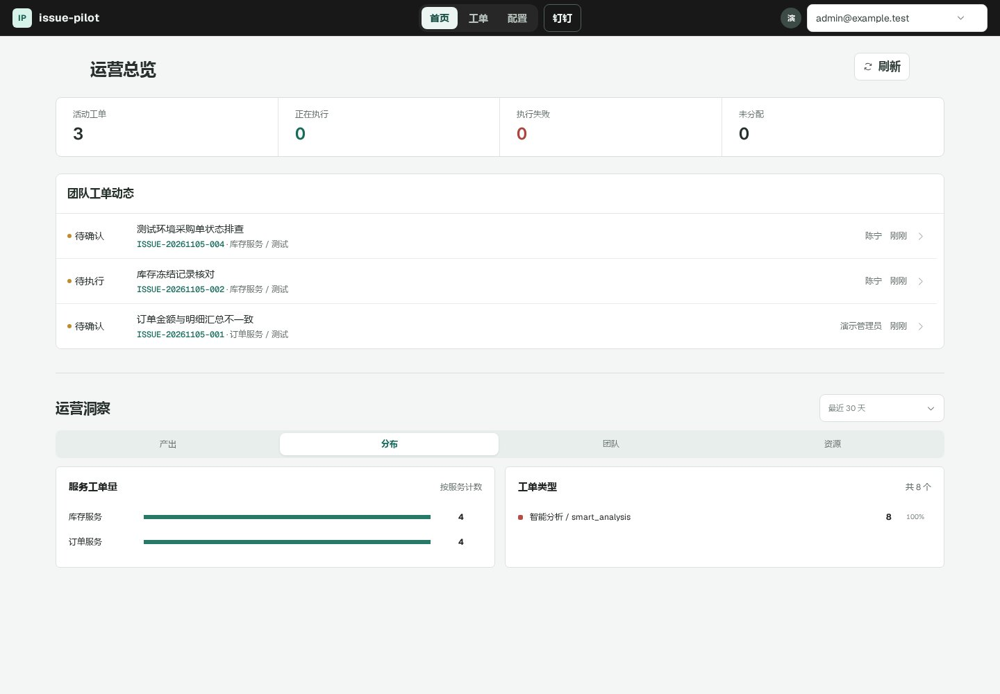
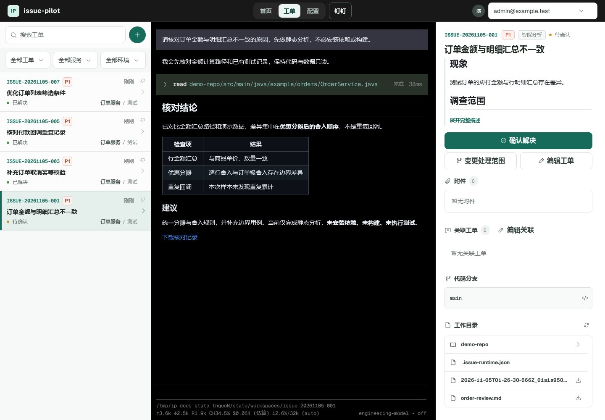
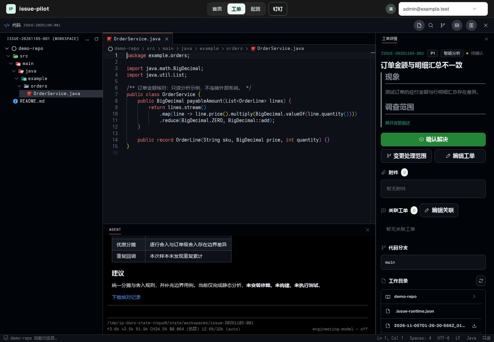
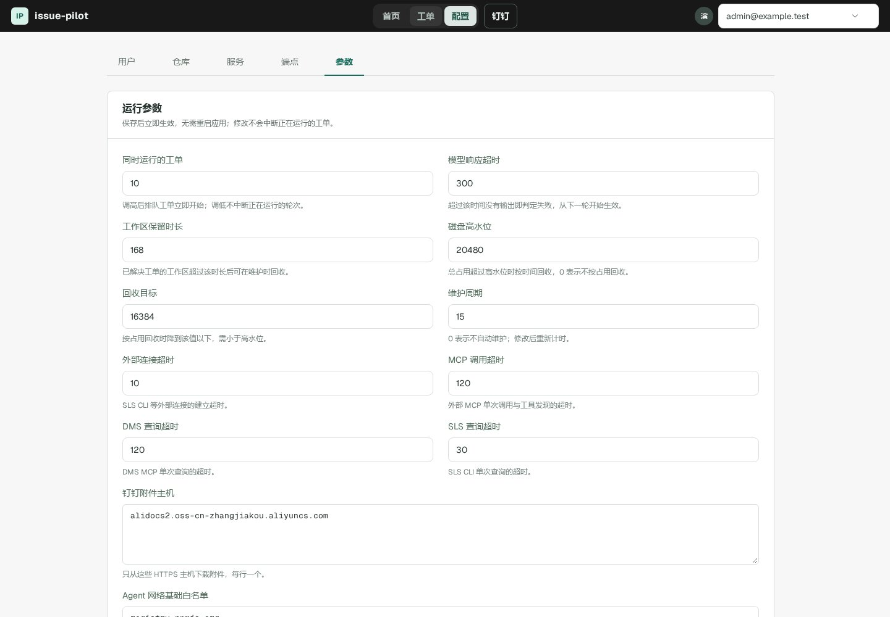

# Issue Pilot

Issue Pilot 是一个基于 [Pi Coding Agent](https://www.npmjs.com/package/@earendil-works/pi-coding-agent) 的 AI 工单协作系统。它将问题描述、对话、附件、处理结果和代码改动组织在同一张工单中，用于问题调查、文件处理与代码开发。

## 工作方式

1. **提交问题**：选择入口服务和处理方式，说明现象、预期与验收条件，按需添加附件、处理人和关联工单。支持页面、钉钉单条记录和入站 MCP。
2. **处理与反馈**：Agent 按工单排队，准备代码与执行环境，在授权范围内读取证据或修改代码。默认优先静态分析，不例行安装依赖或完整构建。
3. **检查结果**：阅读回复、展开工具卡片、下载文件或检查代码差异，再继续反馈或确认解决。对话和文件持久保留，工单可以重开。

## 代码与文件

| 任务 | 工作方式 |
| --- | --- |
| 正式／测试调查 | 对应部署的共享只读代码快照；使用已配置的 DMS、SLS、DBHub 或其他服务 MCP |
| 开发修复／功能开发 | 工单私有分支和 worktree；浏览器提供编辑、差异、暂存与提交 |
| 文件处理 | 附件原件只读；需要修改时显式另存普通工作文件，用普通脚本和库处理 |

关联工单提供只读代码、文件和会话证据，不扩大服务或查询权限。重要结论应核对来源、代码版本和时间。

## 界面

以下为独立演示环境中留存的界面截图，人员、工单和调查结论均为虚构，不包含真实业务数据。截图对应 [manifest](docs/images/manifest.json) 记录的源码版本，并非每次文档更新都会重新捕获；当前交互以[使用指南](docs/USAGE.md)和实际页面为准。

### 运营首页

查看活动工单、团队动态和创建周期内的运营统计。



### 工单会话

将对话、工具结果、描述、代码分支和工作文件集中在一个工作区。



### 代码浏览器

使用 Monaco 查看代码；调查只读，活动开发工单可编辑并检查差异。



### 参数配置

管理员可修改并发、超时、回收策略及网络基础列表；界面说明各项的实际生效时机。



截图版本、生成方式和校验值见[页面图说明](docs/images/README.md)。可重复的当前代码浏览器／会话验收见[开发指南](docs/DEVELOPMENT.md#可重复的真实浏览器验收)，验收截图与这里的展示图不是同一组产物。

## 运行与配置

单个 Node API 提供网页、HTTP、SSE 和无状态入站 MCP，同一 state root 只允许一个 API 实例。默认 API 端口为 3000，可选 4173 Web 入口代理到同一 API。

Pi 管理模型会话、工具管线和外部 MCP 生命周期；应用维护身份、凭证、服务范围及文件／Git 生命周期。模型本地工具和 stdio MCP 经过 SRT，远程服务仍承担自身授权。

用户、凭证、仓库、服务部署与运行参数由页面／API 写入 SQLite。参数 Tab 提供部分运维参数热更新；监听端口、state 路径等仍是部署设置，不是所有常量都可热改。个人模型组整组替换共享组，所选身份失败不会自动换 Key 或用户。

首次运行按[部署指南](docs/DEPLOYMENT.md#首次本地运行)依次准备 Operator 模型目录、安装依赖、启动和配置第一张工单。仅安装 npm 包或全局执行 `pi update` 不会完成应用配置；项目通过本地 Pi SDK 工作，全局 CLI 与项目依赖独立，详见[开发指南](docs/DEVELOPMENT.md#pi-cli-与项目-sdk)。生产访问必须通过可信认证网关，不能把账号选择器或 subject 请求头当作认证。

## 数据目录

```text
.issue-pilot/
├── issues.db{,-wal,-shm}     # 配置、工单关系、参数与绑定
├── git/
│   ├── repositories/       # 共享 Git 对象与引用
│   └── checkouts/          # 共享只读代码快照
├── workspaces/<issue-key>/ # 代码、原件、会话和工作文件
│   └── .issue-git/         # 工单私有 Git 状态
└── control/               # 单实例租约与控制记录
```

这些是敏感业务数据，不是测试夹具。恢复必须匹配数据库、文件、会话与 Git；可再生缓存和共享 checkout 可从恢复点排除，但必须保留精确对象、清单和重建方法。

## 文档

| 阅读目标 | 文档 |
| --- | --- |
| 创建、处理、解决与重开 | [使用指南](docs/USAGE.md) |
| 人员、凭证、服务、参数与 MCP | [配置与协议](docs/CONFIGURATION.md) |
| HTTP 调用、返回值与异步处理 | [HTTP 接口约定](docs/HTTP.md) |
| 系统组成和职责边界 | [系统架构](docs/ARCHITECTURE.md) · [Agent 与能力](docs/AGENT.md) |
| 数据、文件事务和 Git | [数据存储](docs/STORAGE.md) |
| 安装与发布 | [部署指南](docs/DEPLOYMENT.md) · [运维手册](docs/RUNBOOK.md) |
| 开发与验证 | [开发指南](docs/DEVELOPMENT.md) · [依赖补丁](patches/README.md) |

[文档导航与适用版本](docs/README.md#适用范围与读者)
