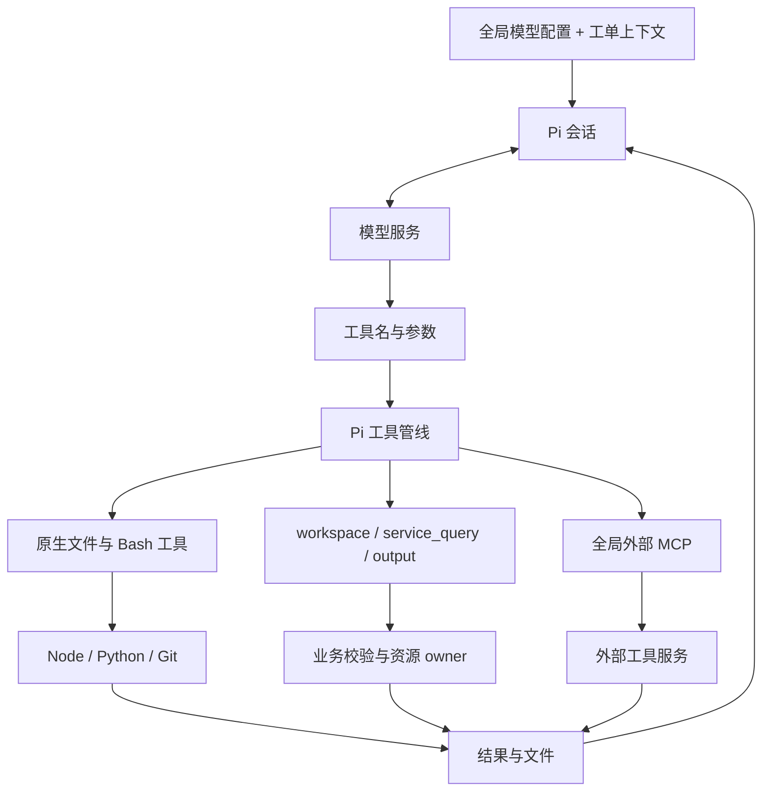

# Agent 与能力

模型决定下一步做什么，pi-coding-agent 管理模型会话与工具管线，Issue Pilot 提供业务规则、凭证和持久化。全局只有一份 provider/model、思考级别和 Codemode 配置，服务部署没有模型覆盖。

## 模型如何使用工具

提示词说明任务和路径，不能代替执行时校验。工具是否存在、参数和目标是否合法、使用谁的凭证，由当前上下文与执行入口决定。

| 工具 | 提供什么 | 何时可用 |
| --- | --- | --- |
| read/bash/edit/write/grep/find/ls | 普通文件操作、脚本与命令执行 | 全部工单，cwd 为持久工单工作目录 `workspaces/<key>` |
| workspace | list/describe/include/remove，服务说明与代码集合 | 全部工单 |
| service_query | 已配置的原生只读证据查询 | 当前上下文有可用原生能力时 |
| output | list/publish，受管成果交付 | 正式数据处理工单 |
| `mcp__<id>__<tool>` 与 resources | 已启用外部服务的工具与资源 | 全局向所有工单开放 |

入口：[context.ts](../src/agent/context.ts)、[engine.ts](../src/agent/engine.ts)、[pi-session.ts](../src/agent/pi-session.ts)、[prompts.ts](../src/agent/prompts.ts)。

## 原生证据查询

可用能力由全局开关与允许的服务/环境部署共同决定。正式/测试工单只能选择本环境来源，开发工单可以显式查询 prod/test。数据库、schema、logstore 等目标在调用时检查，不由模型提交连接凭证。

Pi 的初始校验发生在可修改参数的钩子之前，因此应用工具保留 execute 入口校验；外部 MCP 也在发送前按已发现 schema 验证参数。

DMS 不静默截断完整结果。查询和范围解析的会话都只关闭一次；多重失败保留操作与关闭错误，调用方取消保留原原因，导出关闭失败时保留旧交付。SQL 在连接前校验，握手限流最多退避重试一次；SQL 发送后不自动重放。SLS 通过 `aliyun sls GetLogsV2` CLI 查询，使用短期私有配置注入凭证，保留完整性检查、分页、预算和取消，不再创建证据 Worker。MySQL 走用户配置的外部 MCP，原生适配器及其事务/导出接口已移除。具体目标、操作和预算见[配置与协议](CONFIGURATION.md#内建能力与工具)及[根配置](../issue-pilot.config.ts)。

## MCP 与 Codemode

| 接入 | 调用方向 | 规则 |
| --- | --- | --- |
| 入站 `/mcp` | 外部 AI → Issue Pilot | 复用工单 HTTP 入口的身份与业务检查 |
| 全局外部 MCP | 工单 Agent → 外部服务 | 启用工具向所有工单开放，只读提示不是授权 |
| 原生 DMS MCP | DMS 适配 → DMS 服务 | 指定数据库与受校验的只读操作 |

Pi 拥有外部 MCP 的发现、命名、动态注册、连接复用、重连与关闭。应用保留数据库配置权、传输限制、凭证、预算和发送前校验，不另维护一套工具发现框架。配置格式与传输细节见[全局外部 MCP](CONFIGURATION.md#全局外部-mcp)。

Codemode 让模型用脚本编排现有工具，仍走同一工具管线：

| 模式 | 模型工具声明 | MCP 使用方式 |
| --- | --- | --- |
| off | 原生、应用及直接曝光的 MCP 工具 | 直接调用 |
| on | 原生、应用直接工具，以及 Codemode | searchTools/describeTool 按需发现 |
| only | SDK 隐藏其他模型工具声明，主要通过 Codemode | 同样按需发现和调用 |

on/only 不预先把全部 MCP schema 放入上下文。Codemode 脚本使用进程级、可取消的 FIFO 执行资源队列，一次执行一个脚本，为 SDK 的第二个 Worker 槽位保留退出缓冲；默认最多等待 120 秒、排队 32 个，预算归根配置 `limits.codemode`。等待超时或取消的脚本不执行，不自动重放；脚本内部独立工具调用仍可并行。`service_query`、`workspace`、`output` 返回结构化结果；独立的非 DMS 读取可并行，DMS 批次串行并保留间隔。依赖结果或发布同一文件时顺序执行，只返回模型需要的字段。原生发布与 DMS 导出返回 `downloadPath`，最终回复应使用它生成文件下载链接，不把服务器路径、`file://` 或 `sandbox:` 地址作为下载入口。

## 文件处理与会话

模型通过普通脚本处理文件，应用不提供格式专用执行器。Bash PATH 包含应用 `.venv` 和项目 wrapper，Node 可使用应用已安装的包；当前 Git 身份随调用环境注入。

Python/openpyxl 用于读取、创建和修改 `.xlsx`，支持写入及保留公式，不计算公式结果。旧 `.xls` 不在支持范围内，网页不解析或预览 Excel，文件列表仅提供下载；超出预览大小限制的成果同样不显示预览入口。附件和成果弹窗统一使用下载与关闭操作，只有加载失败时提供重试。发布和文件事务见[数据存储设计](STORAGE.md#文件写入与发布)。

每工单 Pi JSONL 保存消息和分支，恢复时读取 active branch，不从历史消息恢复额外工具权限。只读仓库会话轮次结束后关闭，下一轮准备当前快照并恢复对话；开发空闲会话可以复用。模型响应超时只计等待模型输出，工具执行期间暂停。

Pi 标准 ResourceLoader 从用户全局目录加载 Skills、Prompts、受信扩展和附加指令，应用不再绑定自己的 `.pi` 资源目录；SDK 负责命令展开、嵌套调用和会话格式。资源路径和 settings 见[Agent 基座与资源](CONFIGURATION.md#agent-基座与资源)。凭证归属统一见[凭证与 owner](CONFIGURATION.md#凭证与-owner)。

## 执行边界

原生代码以应用用户权限执行，可访问该用户能读写的文件。工单 cwd 用于组织工作，Source API 的只读策略、Codemode 和容器资源限制都不构成工单间 OS 隔离。

因此这套系统用于可信执行环境。内建证据查询仍检查业务目标，项目命令 broker 也保留自己的命令授权；外部 MCP 的工具行为由配置者确认。
