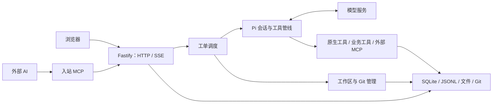
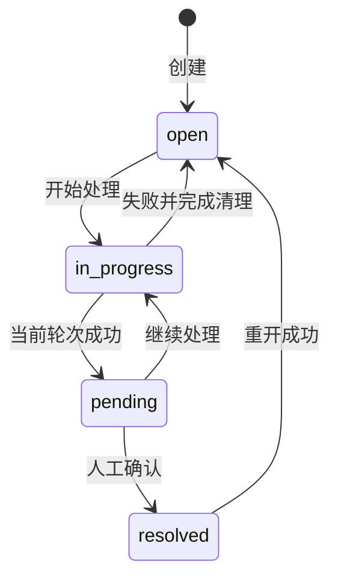
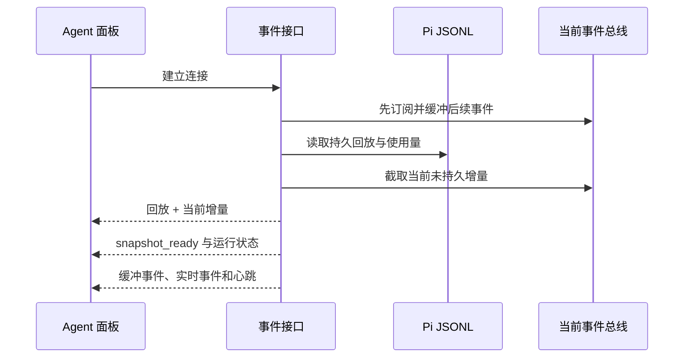

# 系统架构

Issue Pilot 用一个 Node 主进程协调 HTTP、Agent 和工作区。Pi 管理模型交互与工具执行，SQLite、Pi JSONL、文件和 Git 分别保存业务状态、对话与工作成果。

## 系统组成



| 模块 | 职责 | 入口 |
| --- | --- | --- |
| HTTP 路由 | 输入解析、身份检查、预约和事务协调 | [src/http](../src/http) |
| AgentEngine | 每工单排队、活动计数、会话复用和失败清理 | [engine.ts](../src/agent/engine.ts) |
| PiSessionRuntime | 绑定模型、工具、应用资源和会话 | [pi-session.ts](../src/agent/pi-session.ts) |
| 工作区 | 准备代码集合，管理 worktree、释放和恢复 | [src/workspace](../src/workspace) |
| 文件存储 | 附件事务和成果发布 | [attachment-store.ts](../src/http/attachment-store.ts)、[store.ts](../src/outputs/store.ts) |
| 配置 | 凭证选择、配置更新与公开投影 | [src/configuration](../src/configuration) |

路由协调这些 owner，不重新实现 Git、协议或文件存储。入站 MCP 复用 HTTP 业务入口。模型调用可以启动 Bash、Node、Python、Git、stdio MCP 子进程，部分证据查询使用 Worker。

## 工单流程

工单绑定入口服务、环境和类型，必须匹配一个有效的服务部署。创建请求的 `workMode` 决定环境与类型，数据库不另存一份当前 work mode；映射见[配置与协议](CONFIGURATION.md#处理方式)。

创建时先暂存附件并独占 claim 空工单目录，再事务保存 Issue、唯一 Workspace、关联和附件元数据，提交后入队。Agent 选择并校验 owner 凭证，准备工作区，恢复或新建 Pi 会话，然后开始处理。



请求受理、轮次完成、业务解决是不同阶段。模型结束后进入 `pending`，使用者确认后才是 `resolved`；`resolved` 与非空 `resolved_at` 必须等价。

Workspace 独立记录 `not_created/preparing/running/ready/stopped/failed`。`runtime_ready` 记录准备结果，不能代替实际目录和 Git 检查。工作区释放不删除工单，恢复规则见[数据存储设计](STORAGE.md#git-与工作区)。

入口服务不是跨服务调查的资源边界。`workspace include/remove` 管理同环境代码，开发工单可以显式查询 prod/test 证据，查询来源不会改变代码环境。

范围变更使用 plan/apply，结合工单更新时间与 plan hash 拒绝过期方案；支持正式/测试重绑、同服务调查转开发修复及保持 branch mode 的开发跨服务迁移。数据库提交与 Git/文件准备、回滚和最终化分别协调，并保存审计。

## 实时对话与页面状态



先订阅再读快照，避免读取期间丢事件；快照已有的独立 usage 条目按 Pi entry ID 去重。写入器按 FIFO 发送，底层 `write()` 返回 false 时等待 `drain`，连接关闭后清理监听和待发帧。

前端通过 generation 和取消信号拒绝旧连接、旧请求覆盖当前页面。基座草稿、保存队列和失败信息归 `ApplicationResources` 持有，切页保留，身份变化取消旧身份尚未提交的工作。首页 Overview 单独拥有首页请求和轮询。

入口：[agent-routes.ts](../src/http/agent-routes.ts)、[sse.ts](../src/http/sse.ts)、[agent-stream.ts](../src/web/src/app/agent-stream.ts)、[ApplicationResources.tsx](../src/web/src/app/ApplicationResources.tsx)。

## 并发与失败清理

| 协调范围 | 保护什么 |
| --- | --- |
| 每工单 Agent 队列 | 同工单轮次串行，失败清理结束后再执行下一项 |
| Issue-set reservation | 预约一组空闲工单，防止配置或生命周期操作期间启动 Agent |
| API configuration scope | 配置读快照和影响配置范围的写操作 |
| lifecycle queue | 释放、重开、转换与迁移 |
| 每工单 inspection queue | 同一工单的深检与生命周期操作 |
| repository queue | 同一 state root + URL hash 的 Git store 操作 |

锁顺序固定：

```text
配置读取：scope queue → SQLite read snapshot
服务/工单范围写入：scope queue → Issue reservation
释放/重开：lifecycle queue → inspection queue → Issue reservation
```

预约遇到活动工单会拒绝；不能用一个全局 mutex 替代这些协调范围。等待队列后需重新检查相关授权。失败任务先停止会话并清理资源，再回写状态，防止旧轮次覆盖新轮次。排队消息执行时也要确认捕获的会话仍有效。

## 代码浏览与运行生命周期

Monaco 负责文本编辑和差异显示，不加载 VS Code 扩展宿主。Source API 拒绝越界链接和 `.git` 路径，Git 文件参数按字面处理；保存用 SHA-256 检测冲突，前端保留草稿。原生工具的执行边界见 [Agent 与能力](AGENT.md#执行边界)。

启动顺序为：数据库迁移与中断状态恢复 → 检查未知目录和共享 checkout → 启动项目 broker → 准备工单 runtime → 确认模型基座 → 维护与路由 → 监听 HTTP。单个 runtime 可以被报告为 blocked，`/health` 成功不代表全部工单资源或远程服务正常。

队列在内存中，进程重启不会自动恢复未完成的模型调用；持久工单和会话支持后续重试或继续。关闭时先等待维护与 Agent 活动，再释放会话/MCP、模型运行时、broker，最后关闭数据库，清理错误聚合报告。

组装入口为 [api.ts](../src/http/api.ts)，部署和恢复步骤见[部署指南](DEPLOYMENT.md)与[运维手册](RUNBOOK.md)。
