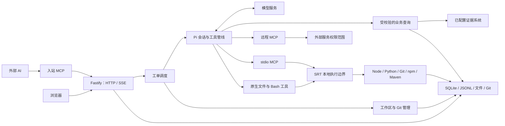
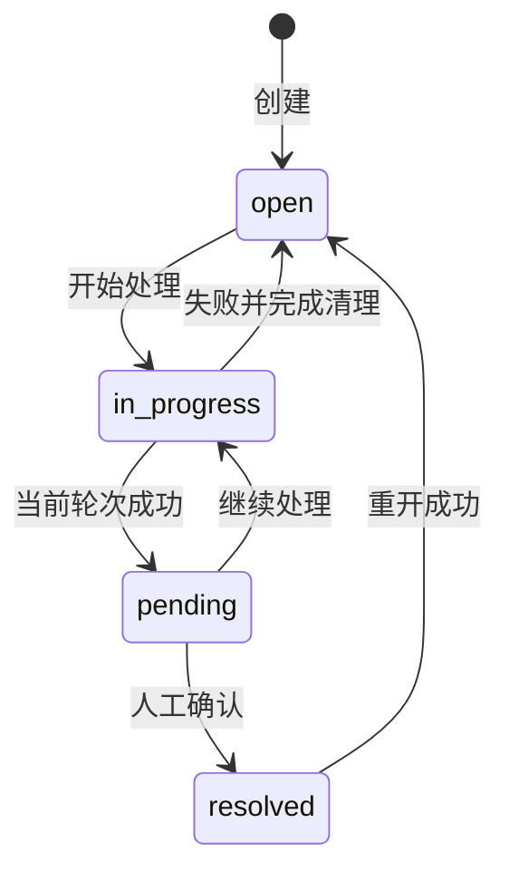
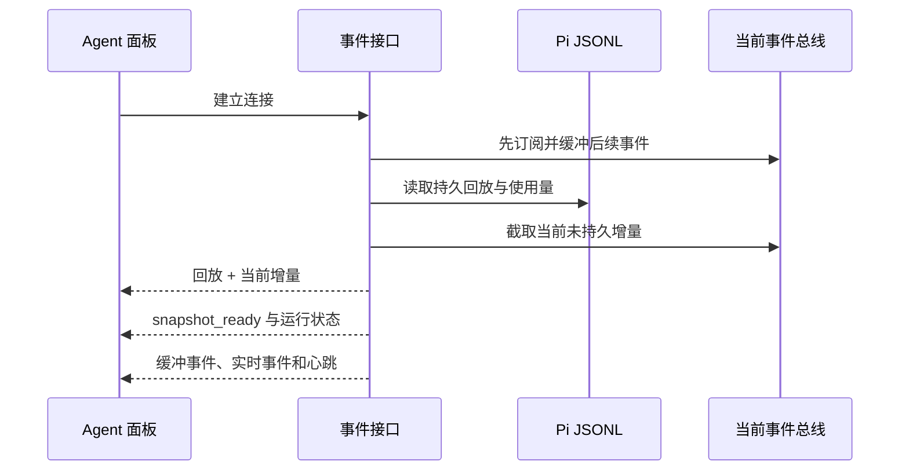

# 系统架构

Issue Pilot 用一个 Node 主进程协调 HTTP、Agent 和工作区。Pi 管理模型交互与工具执行，SQLite、Pi JSONL、文件和 Git 分别保存业务状态、对话与工作成果。

## 系统组成



| 模块 | 职责 | 入口 |
| --- | --- | --- |
| HTTP 路由 | 输入解析、身份检查、预约和事务协调 | [src/http](../src/http) |
| AgentEngine | 每工单排队、活动计数、会话复用和失败清理 | [engine.ts](../src/agent/engine.ts) |
| PiSessionRuntime | 绑定模型、工具、应用资源和会话 | [pi-session.ts](../src/agent/pi-session.ts) |
| 工作区 | 准备代码集合，管理 worktree、释放和恢复 | [src/workspace](../src/workspace) |
| 文件存储 | 附件事务、普通工作文件和原子查询导出 | [attachment-store.ts](../src/http/attachment-store.ts)、[work-files.ts](../src/workspace/work-files.ts) |
| 配置 | 凭证选择、配置更新与公开投影 | [src/configuration](../src/configuration) |

路由协调这些 owner，不重新实现 Git、协议或文件存储。入站 MCP 复用 HTTP 业务入口。模型控制的本地文件工具、Bash 和 stdio MCP 经 SRT 执行；应用自身的 DMS/SLS 查询由业务 owner 绑定配置、注入凭据并验证只读操作。远程 MCP 使用远程服务自身权限。Codemode 使用 Pi 的脚本 Worker，应用没有每工单常驻 Worker 或容器。

开发代码位于工单目录，索引、分支和新对象存于同一工单的 `.issue-git/<url-hash>`。公共 Git 基线只读复用，其他工单和共享库不获得模型写权限。详情见[Git 与工作区](STORAGE.md#git-与工作区)。

日常人员、个人凭证、仓库、服务和查询目标由配置页维护，SQLite 是唯一业务配置来源。旧 user／service 文件配置的加载、导入、导出与转换链路已移除；历史文件不覆盖页面保存，不创建新的文件配置权威源。标准 MCP JSON API 与 Pi 自身资源配置仍由各自 owner 管理。钉钉来源／字段偏好在 user_preferences、application_settings，MySQL 连接由部署 owner 原子维护对应的全局 MCP 条目。

## 工单流程

工单绑定入口服务、环境和类型，必须匹配一个有效的服务部署。创建请求的 `workMode` 决定环境与类型，数据库不另存一份当前 work mode；映射见[配置与协议](CONFIGURATION.md#处理方式)。

创建时先暂存附件，再按当天编号范围使用索引计算下一序号，独占 claim 空工单目录，并事务保存 Issue、唯一 Workspace、关联和附件元数据，提交后入队。Agent 选择并校验 owner 凭证，准备工作区，恢复或新建 Pi 会话，然后开始处理。



请求受理、轮次完成、业务解决是不同阶段。模型结束后进入 `pending`，使用者确认后才是 `resolved`；`resolved` 与非空 `resolved_at` 必须等价。

Workspace 独立记录 `not_created/preparing/running/ready/stopped/failed`。`runtime_ready` 记录准备结果，不能代替实际目录和 Git 检查。工作区释放不删除工单，恢复规则见[数据存储设计](STORAGE.md#git-与工作区)。

入口服务不是跨服务调查的资源边界。`workspace include/remove` 管理同环境代码，开发工单可以显式查询 prod/test 证据，查询来源不会改变代码环境。

范围变更使用 plan/apply，结合工单更新时间与 plan hash 拒绝过期方案；页面切换目标时丢弃旧预检响应，提交变更期间锁定目标。支持正式/测试重绑、同服务调查转开发修复及保持 branch mode 的开发跨服务迁移。数据库提交与 Git/文件准备、回滚和最终化分别协调，并保存审计。

## 实时对话与页面状态



先订阅再读快照，避免读取期间丢事件；快照已有的独立 usage 条目按 Pi entry ID 去重。完整回放与缓冲重叠保留完整去重范围，完成激活后，临时事件只保留根配置 `http.sseRecentEventIds` 指定的近期 ID 窗口（默认 4096），不随流式 token 数持续增长；持久条目 ID 仍按连接生命周期去重。实时临时事件不提供无限期 ID 去重。

写入器按 FIFO 发送，每轮批量移除已发送帧，避免积压时逐帧移动数组；底层 `write()` 返回 false 时等待 `drain`，连接关闭后清理监听和待发帧。事件序列化失败时也取消订阅并关闭连接，允许客户端重新连接，不留下仅发送心跳的假连接。近期 ID 窗口不等于网络背压的容量上限。

配置分类按首次访问加载，保留访问过的组件实例和筛选；默认用户页只读取当前凭证与人员管理资料，不因隐藏服务页触发完整配置、重复仓库列表、端点或私有说明请求。人员／仓库的刷新重试同时恢复其共享资料，并等待本次并行读取收尾，不重复提交已经完成的写入。

前端按身份、工单和请求序号隔离异步结果，保留等待期间的新草稿。基座草稿、保存队列和失败信息归 `ApplicationResources` 持有，切页保留；基座异步结果同时校验 subject 和身份代次，从 A 切到 B 再回到 A 后，旧保存或刷新也不能覆盖当前草稿、恢复旧失败或重新排入重试。服务与 MCP 编辑器在身份/权限变化或关闭时清理敏感草稿，普通资料刷新不打断编辑。服务编辑器的私有 MySQL 加载按弹窗代次隔离，关闭、重新打开和新建都会使旧结果失效；冲突后的重新加载位于编辑错误区域，成功保存后恢复忙碌状态。服务写入成功与读取刷新分开反馈：刷新失败时结束已成功的编辑操作、保留错误并只重试读取，不要求再次提交写入。用户编辑器在身份或权限变化时关闭，并隔离旧请求的错误与忙碌状态；成功写入后继续刷新共享用户资料，卸载后不再加载本地用户列表。仓库草稿在同一身份和角色的资料刷新时保留，列表按身份和请求序号隔离迟到响应，卸载后请求失效。编辑行按服务和环境保持稳定，普通配置刷新不重建未保存的草稿。首页 Overview 单独拥有首页请求和轮询。Workspace 存储仅在首次访问资源分类时读取；已加载数据在刷新期间保留，显示采样时间，手动刷新可重新采样，读取失败可原地重试。统计完成快照缓存不参与释放授权，实际释放继续在预约内实时检查。附件预览关闭或换文件时取消下载，复制失败不隐藏已加载内容。

工单详情按工单、身份和角色维护操作上下文，新建表单按身份和角色维护上下文；卸载时均使旧回调失效。已发出的写请求仍可能在服务端完成。新建入口等待身份解析完成；创建成功后刷新队列并隔离旧列表响应，关联候选请求按弹窗打开次数隔离，新建与编辑关联弹窗在关闭/重开时均使旧请求失效；编辑关联的迟到成功、失败和 loading 收尾都不能覆盖新弹窗。评论发布仅清理仍与已提交内容相同的输入，等待期间的新草稿保留；同身份仅刷新姓名等资料不清空草稿。

工单列表摘要和启动时只读 runtime 的仓库加载按小批次绑定 ID，避免工单总数超过 SQLite 的参数上限；列表仍返回完整结果及既有顺序，不静默截断。

入口：[agent-routes.ts](../src/http/agent-routes.ts)、[sse.ts](../src/http/sse.ts)、[agent-stream.ts](../src/web/src/app/agent-stream.ts)、[ApplicationResources.tsx](../src/web/src/app/ApplicationResources.tsx)。

## 工单导航与关联材料

工单链接固定使用应用根路径 `/?issue=<key>`。关联卡片展示编号、处理人、状态、服务及环境，标题只在悬停时展示；列表限高并内部滚动。普通点击在当前应用中切换工单，保留当前身份和队列筛选；Ctrl／⌘ 或中键可在新标签打开。关联跳转记录浏览器历史，后退／前进恢复对应工单；有未保存代码时先确认，拒绝后恢复当前地址和草稿。

Markdown 与原始 HTML 链接统一经工单文件解析和 HTML 清洗。同源历史 `issues/<key>/work` 与当前工作目录路径映射到文件 API；显式关联的其他工单工作文件通过当前关系的只读引用访问。未关联工单、路径越界、Git 控制文件和未知本地路径不会转换成可下载链接。普通外部网页链接保持原语义。

数据库保存有方向的 `issue_relations`。准备工作区时生成 `.related-<key>.json` 元信息快照，并建立关联目录及可用会话的只读链接。修改关联会关闭原会话并重新排队准备。原工单后续变化不会自动改写当前工单的回答，也没有后台摘要、结构化三类摘要或预览弹窗。复用的开发会话继续处理时没有重新生成关联元信息；目录和会话链接也应按实际绑定核对，不能把准备时快照描述成永远最新。

## 并发与失败清理

| 协调范围 | 保护什么 |
| --- | --- |
| 每工单 Agent 队列 | 同工单轮次串行，失败清理结束后再执行下一项 |
| 每工单 Pi 会话访问队列 | 会话打开、排队输入写入、SDK 初始化和关闭串行，避免多个 SessionManager 同时写出分叉 |
| Issue-set reservation | 预约一组空闲工单，防止配置或生命周期操作期间启动 Agent |
| API configuration scope | 配置读快照和影响配置范围的写操作 |
| lifecycle queue | 释放、重开、转换与迁移 |
| 每工单 inspection queue | 同一工单的深检与生命周期操作 |
| repository queue | 同一 state root + URL hash 的 Git store 操作 |
| Codemode 执行资源队列 | 进程级脚本 Worker 入场、等待预算与取消，不代替工单和配置队列 |

锁顺序固定：

```text
配置读取：scope queue → SQLite read snapshot
服务/工单范围写入：scope queue → Issue reservation
释放/重开：lifecycle queue → inspection queue → Issue reservation
Agent 轮次：Issue round queue → Pi session access queue
流式发送：steer queue → Pi session access queue（需要转入普通回合或清理时）
```

预约遇到活动工单会拒绝；不能用一个全局 mutex 替代这些协调范围。等待队列后需重新检查相关授权。应用外部命令执行器在创建进程前检查取消，没有 PID 时不发送终止信号。发生取消、超时、流错误或输出消费错误时，保留首个错误，等待 stdio 关闭及必要的进程组终止升级完成后才释放执行资源。工作文件按真实目标路径跨实例串行；附件清理等待所有暂存目录结束并聚合原操作与清理错误。失败任务先停止会话并清理资源，再回写状态，防止旧轮次覆盖新轮次。排队消息执行时也要确认捕获的会话仍有效。

## 代码浏览与运行生命周期

Monaco 负责文本编辑和差异显示，不加载 VS Code 扩展宿主。变更列表保持单行并优先显示文件名，窄侧栏隐藏同行目录，完整路径保留现有悬浮提示。Source API 检查读取的解析路径和写入父目录，拒绝越界访问及 `.git` 别名；行归属查询读取前检查普通文件，拒绝目录、FIFO 等特殊文件；删除、重命名操作链接本身，不跟随链接操作目标；覆盖重命名先隔离旧目标，失败时恢复，最终化失败保留备份并报告。Git 文件参数按字面处理；保存用 SHA-256 检测冲突，同目录临时文件使用固定长度的随机名称，支持接近文件系统名称上限的源文件，前端保留草稿。路径越界按 `..` 路径段判断，允许 `..notes` 等合法名称。历史查询读取 Git 记录，不要求文件仍存在于当前工作树；版本内容直接通过一次 `cat-file blob` 读取，并按原始字节流严格解码 UTF-8，拒绝无效编码而允许合法的 U+FFFD 字符。暂存差异的版本来源为 HEAD → Index，工作区差异为 Index → Working Tree。共用 DTO、变更状态和文件版本枚举归 [source-contracts.ts](../src/workspace/source-contracts.ts)；Source owner 与 Web 客户端共同依赖这个轻量契约模块，Web 按共享枚举校验响应。原生工具的执行边界见 [Agent 与能力](AGENT.md#执行边界)。

默认启动顺序为：占有应用实例控制 Socket → 数据库迁移与中断状态恢复 → 读取 SQLite 业务配置 → 检查未知目录和共享 checkout → 准备工单 runtime → 确认模型基座 → 维护与路由 → 监听 HTTP。竞争实例在数据库恢复与目录清理之前拒绝；控制 Socket 只用于实例互斥，不接受项目命令。单个 runtime 可以被报告为 blocked，`/health` 成功不代表全部工单资源或远程服务正常。

消息返回 `202` 前先把原文和图片保存到已有 Pi JSONL，并保存会话绑定；写入失败不入队，不完整的 JSONL 保留并拒绝追加。队列在内存中，进程启动不自动恢复模型调用。用户主动继续时，应用只恢复带版本标记、原范围一致且未开始交付的输入；started 输入不重新注入，旧范围输入记录拒绝并保留原文。JSONL 交付规则由 [message-delivery.ts](../src/agent/message-delivery.ts) 统一管理，Engine 负责排队、当前身份、准备和执行协调；没有新增任务服务或 SQL 消息表。关闭时先等待维护与 Agent 活动，再释放会话/MCP、模型运行时、SRT 代理、应用实例租约，最后关闭数据库，清理错误聚合报告。单工单会话停止和个人 Git 临时身份清理都会尝试执行；单一失败保留原错误，多重失败聚合报告，避免后一个清理异常覆盖前一个。应用租约的并发启动共享同一次初始化，关闭等待启动结束；重复关闭共享清理结果，再次启动等待前次关闭完成。Native 工具和代码集合 include/remove 共享每工单本地执行队列，并等待取消后的进程退出；不同工单可并行。重复的 SRT 命令清理调用共享同一次关闭结果，SRT 共享代理另有生命周期队列。

组装入口为 [api.ts](../src/http/api.ts)，部署和恢复步骤见[部署指南](DEPLOYMENT.md)与[运维手册](RUNBOOK.md)。
