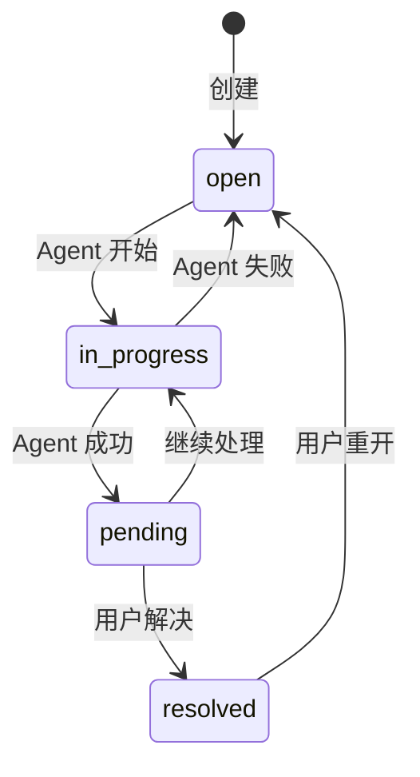
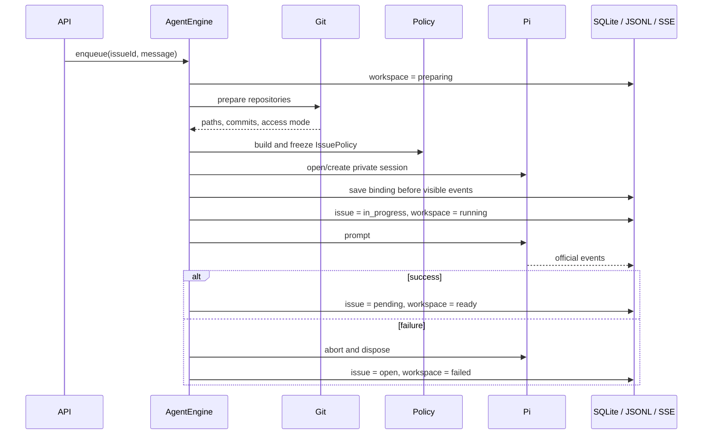
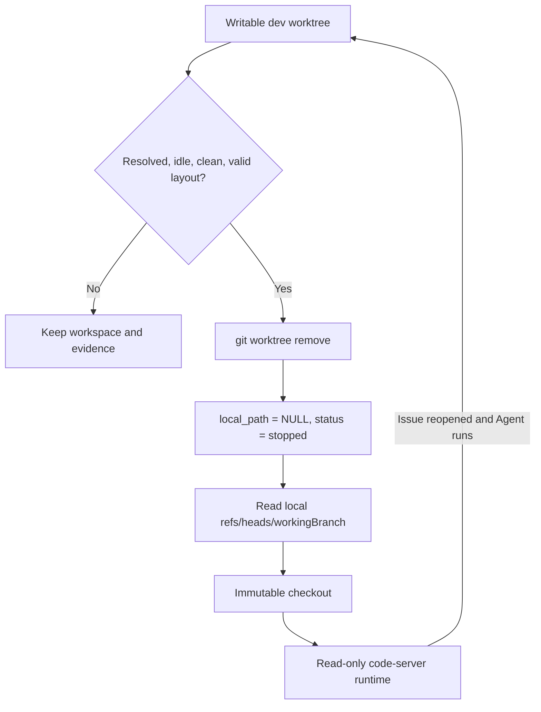

# 架构说明

本文解释 Issue Pilot 的业务状态、数据所有权和运行原理。源码入口和改动方法见 [开发指南](DEVELOPMENT.md)，字段怎么填见 [配置说明](CONFIGURATION.md)，首次部署见 [部署说明](DEPLOYMENT.md)，日常维护见 [运维手册](RUNBOOK.md)。

## 核心术语

| 术语 | 在 Issue Pilot 中的含义 |
| --- | --- |
| Issue | 一张工单，也是 Agent、session、附件和代码上下文的隔离单位 |
| Service | 一组 Repository 及其各环境配置 |
| Deployment | 某个 Service 在一个 Environment 下的分支、模型和 capability 配置；不是发布进程 |
| Repository | Service 使用的一个 Git remote |
| Bare repository | 跨 Issue 共享的 Git object/ref store，不包含普通工作目录 |
| Workspace | 活动 dev Issue 的可写目录；也泛指 Agent 当前 cwd |
| Worktree | Git 从 bare repository 挂出的具体工作目录 |
| Immutable checkout | 按 commit 定址的只读、可重建 Git worktree |
| Runtime | `issues/<key>/runtime` 下供 code-server 使用的生成资源，不保存持久业务数据 |
| Session | 一个 Issue 对应的持久 Pi JSONL 对话分支 |
| Policy | 某次 Agent session 冻结后的代码和 capability 授权 |
| Capability | Nacos、数据库、Redis、SLS、Playwright 等受限外部读取工具 |

## 设计原则

Issue Pilot 的核心不是“为每个工单复制一个项目”，而是把不同生命周期的数据分开管理：

- 工单、Deployment 和状态由 SQLite 管理。
- Repository 对象和本地工作分支由共享 bare Git repository 管理。
- 附件和 Pi JSONL 按 Issue 持久保存。
- Immutable checkout、runtime manifest 和 wrapper 是可重建生成物。
- Dev workspace 保存可写代码、依赖和构建输出，可以在严格预检后回收。

这种划分让系统可以释放大体积构建目录，同时保留恢复工单所需的信息。

## 组件边界

| 组件 | 责任 | 运行位置 |
| --- | --- | --- |
| SolidJS Web | 工单、配置、对话、统计和 code-server UI | 浏览器 |
| Fastify API | HTTP、事务、启动恢复、SSE | 宿主 Node.js |
| AgentEngine | 每工单串行执行、状态转换、Pi session 生命周期 | API 进程 |
| SQLite / Drizzle | 业务事实源和 schema migration | 宿主文件 |
| Workspace manager | bare repository、checkout、worktree 和回收 | 宿主 Git |
| Capability broker | 冻结授权并调用受限 client | API 进程/宿主子进程 |
| code-server | 查看或编辑工单代码 | 共享 Podman 容器 |
| Playwright | 单次声明式浏览器任务 | 临时 Podman 容器 |

模块按照事务、安全边界和稳定职责拆分。相关小型 helper 归回拥有它们的模块：共享业务谓词位于 `domain/contracts.ts`，workspace 路径、文件状态和 Repository 分类位于 `workspace/state.ts`，runtime 生成与批量恢复位于 `workspace/runtime.ts`，Pi session 文件与 SDK 生命周期位于 `agent/pi-session.ts`。HTTP route 不直接实现 Git 和 capability 逻辑；Agent 不直接读取页面表单；client 不信任上层已经完成授权。

## 业务状态

### 工单状态



`resolved` 工单不能运行 Agent。新建工单会自动入队；同一工单严格串行，不同工单可以并行。

### Workspace 状态

Workspace 状态描述执行基础设施，不描述业务进度：

| 状态 | 含义 |
| --- | --- |
| `not_created` | 尚未准备代码和 session |
| `preparing` | 正在准备 repository、runtime 和 policy |
| `running` | Pi 正在处理当前轮次 |
| `ready` | 当前轮次完成，可继续对话 |
| `stopped` | Dev workspace 已释放，保留只读 branch runtime |
| `failed` | 准备或执行失败，可重试 |

工单状态和 workspace 状态分开保存。例如 Agent 失败后，工单回到 `open`，workspace 变为 `failed`；已释放的 resolved dev 工单则是 `resolved + stopped`。

## Agent 执行



执行时先读取 Issue 对应的 Service 和 Environment，再选择代码模式。Repository 准备完成后才创建 policy，因此 policy 中的 path、commit 和读写权限来自实际准备结果，而不是页面声明。

Session binding 在第一个可见事件之前写入 SQLite。这样 SSE 客户端不会看到一个无法回放的临时会话。

Prod/test 每轮结束后释放内存 session；下一轮重新获取 Deployment 最新 commit。Dev session 可以留在内存中继续对话，直到配置变化、显式关闭、失败或 API 停止。

## Repository 状态模型

数据库中的 `local_path` 和 `working_branch` 共同决定代码状态。所有调用点使用同一个分类器：

| 状态 | `local_path` | `working_branch` | 说明 |
| --- | --- | --- | --- |
| `read_only` | 全部 `NULL` | 全部 `NULL` | prod/test snapshot |
| `development_workspace` | 全部非空 | 全部非空 | 活动 dev worktrees |
| `development_snapshot` | 全部 `NULL` | 全部非空 | 已释放 dev branch snapshots |
| `invalid` | 其他组合 | 其他组合 | 不推断、不修复，明确失败 |

空 repository 列表也属于 `invalid`。这避免“部分 repository 可写、部分只读”或 stale `local_path` 被误判为正常状态。

Environment 与 Issue type 如何映射到这些状态，见 [Environment 与 Issue type](CONFIGURATION.md#environment-与-issue-type)。

## Git 存储原理

### Shared bare repository

每个 Repository URL 对应：

```text
git/repositories/<url-sha256-prefix>
```

它同时保存：

- `origin/<baseBranch>` 等远程跟踪 ref。
- Dev Issue 的本地 `refs/heads/<workingBranch>`。
- Worktree metadata 和 Git objects。

Repository URL 的操作按 hash 串行，避免并发 fetch/worktree 命令互相修改 metadata。

### Immutable checkout

只读代码按完整 commit 定址：

```text
git/checkouts/<url-sha256-prefix>/<commit>
```

相同 Repository 的相同 commit 只有一份 checkout，不区分 Issue 或分支名。Checkout 使用 detached HEAD，因为文件内容只由 commit 决定；分支 ref 仍保存在 bare repository，Git Graph 可以读取这些 ref。

创建或复用 checkout 时会验证：

- 目录确实是 Git worktree。
- `HEAD` 等于目标 commit。
- `git status --porcelain` 为空。
- Relative worktree metadata 可以 repair。

Shared checkout 本身是生成物。API 冷启动会删除并按当前 ref 重建，避免长期积累失效 commit。

### Dev worktree

Dev workspace 路径由当前模型唯一推导：

```text
workspaces/<issue-key>/<repository-name>
```

Repository basename 冲突时追加 URL hash。数据库中的 `local_path` 必须等于推导结果；不一致时返回 `workspace_path_does_not_match_repository`，不会自动移动旧目录。

Dev worktree 使用本地 `hotfix-<issue-key>` 或 `feature-<issue-key>` 分支。Git metadata 使用 relative paths，使宿主和 code-server 容器在相同 state tree 下都能解析。

### Released dev



Released dev 的权威代码来源是本地 bare repository 中的工作分支。系统不会 fetch 同名远程 Issue 分支，也不会在本地 ref 缺失时用远程内容兜底。

这一区分很重要：Deployment `baseBranch` 表示环境基线；Issue `workingBranch` 表示该工单自己的工作结果。远程 Issue 分支可以被删除，但用于后续重建的 Deployment base branch 仍应可访问。

## 状态与所有权

```text
.issue-pilot/
  issues.db
  issues/<issue-key>/
    attachments/<uuid>-<name>
    agent/<pi-session>.jsonl
    agent/<session>.runtime.json
    runtime/<repository-link>
    runtime/<issue-key>.code-workspace
    runtime/bin/{node-project,maven-project}  # writable dev only
  git/
    repositories/<url-hash>/
    checkouts/<url-hash>/<commit>/
  workspaces/<issue-key>/<repository>/
  backups/
  code-server/
```

| 数据 | 所有者 | 可重建 | 自动删除规则 |
| --- | --- | --- | --- |
| SQLite | Database | 否 | 从不自动删除 |
| Attachments | Issue | 否 | 只通过附件 API 删除 |
| Pi JSONL / sidecar | Issue | 否 | 从不随 workspace 删除 |
| Bare repositories / local branches | Git | 否 | 不作为缓存清理 |
| Runtime / manifest / wrappers | Runtime builder | 是 | 冷启动原子重建 |
| Immutable checkouts | Git | 是 | 冷启动重建 |
| Dev workspace | Issue execution | 是 | 仅受管 release |
| Database backups | Operator | 否 | Operator 自己管理 |

`issues/<key>/runtime` 只能放生成物。附件不会复制或链接到 runtime，Agent 直接读取 durable attachment root。

### 未登记目录

数据库中不存在、但 `issues/` 或 `workspaces/` 中存在的 Issue 目录称为 unmanaged state。它可能来自数据库回滚、部分复制或人工操作。

启动会在删除任何生成物之前检查 unmanaged state；发现后返回 `unmanaged_issue_state` 并停止。这样较新的附件、JSONL 或 dirty workspace 不会因为数据库较旧而被误删。

## 启动与当前状态

启动按以下顺序执行：

1. 创建或打开 `0600` SQLite 数据库。
2. 设置 busy timeout 和 WAL，按 journal 执行 Drizzle migrations，再启用 foreign keys。
3. 把进程中断的运行状态转为可重试状态。
4. 确保 `prod`、`test`、`dev` 环境存在。
5. 验证 state root 中没有 unmanaged Issue 目录。
6. 删除可生成 runtime/checkouts，prune worktree metadata。
7. 重建活动和已释放 dev runtime。
8. 为有 session 的 prod/test 工单 fetch 最新 Deployment commit 并重建 runtime。
9. 执行一次 workspace maintenance，然后注册路由。

启动不识别旧文件布局，不移动旧目录，也不修复不符合当前模型的 `local_path`。

Drizzle migration 是数据库 schema 的顺序升级机制，不是文件系统兼容层。Migration 文件和 journal 一旦发布就不修改、不合并、不删除。

## Runtime 与 code-server

每个已准备代码的 Issue 都生成相同形态的 multi-root runtime：

```text
issues/<issue-key>/runtime/
  <repository-name> -> worktree 或 immutable checkout
  <issue-key>.code-workspace
  bin/                                      # writable dev only
```

活动 dev 的 Repository link 指向 `workspaces/<issue-key>/<repository>`；prod/test 和 released dev 指向 shared checkout。真实可写代码、依赖和构建输出仍只存在于 `workspaces`，runtime 只保存可重建链接、manifest 和 wrapper。

所有 code-server URL 都打开同一个入口形式：

```text
?workspace=/home/coder/state/issues/<issue-key>/runtime/<issue-key>.code-workspace
```

Manifest 显式声明每个 Repository link，因此 VS Code Git extension 在三种代码状态下都使用相同发现方式，并显示 Source Control 和 Git Graph。活动 dev 通过链接最终访问容器中的 read-write workspaces mount；其他链接最终访问 read-only checkouts mount。

Runtime 通过临时目录完整生成后再替换，避免 code-server 看到只生成一半的 links 或 manifest。Manifest 为 `0400`，整个 `issues` mount 在容器内只读；链接目标是否可写由 workspaces/checkouts mount 决定。

具体 mounts 见 [部署说明](DEPLOYMENT.md#code-server)，故障处理见 [运维手册](RUNBOOK.md#code-server-排障)。

## Pi session 与 SSE

Pi 使用 SDK `createAgentSession()`，不启动 RPC 子进程。每个 Issue 只有一个 session binding，JSONL 是唯一 transcript。

Session resource loader 明确关闭 extension、skill、prompt template、theme、context file 和宿主自定义 prompt 自动发现。模型、thinking level 和 active tools 在 session 创建后再次核对。

回放流程遵循 Pi 的 active branch 和 compaction：

- `buildContextEntries()` 生成当前有效上下文。
- User custom entry、assistant message、tool result、summary 和 bash execution 投影为 Web 事件。
- Model change、label 等内部 entry 不伪装成聊天消息。
- 先建立 live event buffer，再读取 replay snapshot，最后接通 live sink。
- SSE write 遇到 backpressure 时等待 `drain`；连接关闭后释放 listener 和 heartbeat。

Web 只负责 presentation，不维护第二份对话事实源。

## Policy 与 capability


IssuePolicy 保存 model、Environment、Repository path/commit/access 和无 credential scope。Password、AccessKey 和 bearer token 不进入 policy 或 prompt。

本地工具由实际 Repository access 决定：

- 至少一个 Repository 且全部为 writable dev：启用 `bash`、`edit`、`write`。
- 其他状态：只启用 `read`、`grep`、`find`、`ls`。

Capability 只为 policy 中列出的名称创建。Broker 会再次比较冻结 scope 和当前 session 持有的 Deployment config，然后由具体 client 验证协议、timeout、rows 和 bytes。

Capability 的字段和限制集中在 [配置说明](CONFIGURATION.md#capability-总览)，此处不重复。

## 附件原理

上传时先按请求预算读取文件并计算 SHA-256，再以 `0400` 写入 Issue attachment root，最后在数据库事务中创建记录。数据库失败会删除已写文件。

读取时验证：

- 路径直属当前 Issue attachment root。
- 对象是普通文件。
- Group/world 权限为 0。
- 文件大小等于数据库记录且不超过上限。
- 当前 SHA-256 等于保存值。

删除使用 quarantine：先把目标原子改名，数据库事务成功后删除；事务失败则恢复原文件名。这避免数据库记录和文件删除一半。

## 并发与失败边界

- Agent 按 Issue ID 串行。
- Git 操作按 Repository URL hash 串行。
- Workspace inspect、release 和 maintenance 全局串行。
- Issue key 生成在 API 实例内串行，并由数据库 unique index 兜底。
- Service 配置整体在一个数据库事务中替换。
- API 装配失败和正常关闭都停止维护、关闭 Agent、Fastify 和数据库。

## 从原理进入代码

理解上述状态与所有权后，可通过 [开发指南](DEVELOPMENT.md)找到源码入口、常见改动路径、测试范围和 review checklist。架构文档不重复维护文件清单。

## 必须保持的不变量

1. Issue key 格式为 `ISSUE-YYYYMMDD-NNN...`。
2. Prod/test Repository state 为 `read_only`。
3. 活动 dev 为 `development_workspace`；已释放 dev 为 `development_snapshot`。
4. Dirty、untracked、running、invalid layout 和 unmanaged state 不自动删除。
5. 本地 Issue branch ref 不随 workspace 释放。
6. Durable data 不进入 runtime 或 checkout。
7. API、database migration 和 code-server 使用同一个 state root。
8. Credential 不进入 policy、prompt、session event 或进程命令行。
