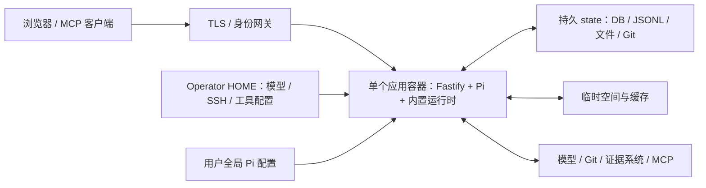

# 部署指南

应用支持主机运行和单副本容器部署，两者使用相同的状态与身份规则。容器内置 Node、Python/openpyxl、Git、Java/Maven 和 aliyun CLI，Fastify 同源提供网页、API、SSE 和入站 MCP；主机开发可以另启 Vite 前端。业务数据独立持久化，同一 state 同时只允许一个 API 实例。已有状态升级先按[运维手册](RUNBOOK.md)备份和演练。

## 部署结构



应用代码、npm 生产依赖、Python `.venv` 和编译后的网页随镜像发布。启动不下载基础运行时，也不启动每工单容器或 Excel 服务。Bash 自动使用应用 `.venv`。

[Containerfile](../Containerfile) 使用 Node 构建网页、移除 dev 依赖，复制 Git 与 Java/Maven 产物，再安装 Python 库，以 UID/GID 1000 启动。Node 固定到主版本 26，Python 跟随 Debian bookworm，库版本见 [package-lock.json](../package-lock.json) 和 [requirements.txt](../requirements.txt)。Git 2.56.0 采用官方 `NO_RUST` 构建选项，aliyun CLI 固定为 3.5.2；开发机的软件版本应独立核对，构建镜像不会升级宿主机。基础镜像没有固定摘要，不能声称逐字节可复现。

`npm ci` 会校验并应用 Pi 1.4.0 输出回调和 node-forge 1.4.0 验签回补；Git 是安装脚本的必要工具，版本或补丁不匹配即安装失败。私有配置在 state root 中独立部署，不复制进镜像。详见[依赖补丁](../patches/README.md)。

## 首次本地运行

Linux 开发环境需要 Python 3.8+（支持 venv）、Git、ripgrep、fd/fdfind、OpenSSH、bubblewrap、socat、proxychains4、aliyun CLI（镜像固定 3.5.2），以及目标项目需要的 npm、Java/Maven。开发与 CI 使用 Node 24.18.0。在新项目副本检查[根配置](../issue-pilot.config.ts)，准备模型凭证和 SSH 配置后执行：

```bash
npm ci
python3 -m venv .venv
.venv/bin/python3 -m pip install -r requirements.txt
npm run build
node --experimental-strip-types src/http/production.ts
```

默认端口 3000。前端开发另运行 `npm run dev:web`，默认 4173，代理本机 API。修改 TS 文件不会自动重载后端，Vite HMR 不能代替发布。

默认 state 位于安装目录 `.issue-pilot`，没有 state/database 环境变量覆盖。日常配置通过页面写入 SQLite。若从现有文件初始化，在停服并建立恢复点后显式运行 `scripts/import-configuration.ts --state-root ROOT --apply`；启动不会自动读取文件或覆盖页面修改。已有状态必须先准备配置和工作目录迁移方案，不能直接搬动 Git worktree。隔离运行需要独立项目及根配置，不能启动第二个 API 指向真实 state。

已有工作站的 user systemd unit 为 `issue-pilot-api.service` 和 `issue-pilot-web.service`，由宿主管理，仓库不提供通用安装脚本。日常 4173 入口使用 `vite preview --config src/web/vite.config.ts --strictPort` 提供已构建页面，API／MCP 仍代理到 3000；修改前端后先构建再切换。`npm run dev:web` 仅在需要 HMR 的开发中使用，不作为日常入口，避免向浏览器传输整个开发模块图。操作前核对 WorkingDirectory、ExecStart 和 PID：

```bash
systemctl --user show issue-pilot-api.service issue-pilot-web.service --property=MainPID,ExecStart,WorkingDirectory --no-pager
```

## 容器构建与 Kubernetes

在独立构建 checkout 按[开发指南](DEVELOPMENT.md#验证)完成检查，再构建和发布镜像：

```bash
podman build -f Containerfile -t registry.example.com/issue-pilot:<version> .
podman push registry.example.com/issue-pilot:<version>
```

构建网络需能访问基础镜像、锁文件 npm 下载地址、Python 包源、Debian 仓库和 Git 源码。替换 registry、版本和 namespace 占位符后，使用 [deploy/issue-pilot.yaml](../deploy/issue-pilot.yaml)。

清单为单副本、Recreate，使用本地 SQLite、进程内队列与受管 Git stores，不支持通过直接增加 replicas 共享写入。容器以 UID/GID 1000 运行，只读根文件系统，移除 capabilities，不自动挂载 ServiceAccount token。SRT 在容器内执行工具，目标节点须支持非特权 user/PID/mount/network namespace 及 seccomp；保留正常隔离配置，不通过 privileged、全量开放 socket 或弱隔离选项绕过失败。仅 /health 成功不能代替实际工具隔离验收。

| 宿主或 volume | 容器路径 | 内容 |
| --- | --- | --- |
| `/var/lib/issue-pilot` hostPath | `/opt/issue-pilot/.issue-pilot` | 全部业务 state |
| `/etc/issue-pilot`，只读 hostPath | `/home/node` | Operator Pi、SSH、工具配置 |
| tmp emptyDir | `/tmp` | 临时文件 |

Node/Maven 缓存分别属于工单根目录 `.npm-cache` 和 `.maven-cache`，Java 与工具 TMPDIR 同属工单根目录。npm/mvn 直接执行，应用按工单协调本地工具，不提供命令 broker 或包装器。Operator 包源配置沿用正常 npm/Maven 读取方式；所需私有目标加入数据库全局 Agent runtime.networkAllowedDomains（域名或 `host:port`），并验证实际私有仓库与 stdio MCP 连接。SSH Git 目标应包含对应 22 端口；“host is not on the allow list”属于本地工具网络策略，不等于 Git 权限验证失败。离线导入需按运维流程停止写入并备份；导入后按匹配版本重启。

准备目录、owner/mode、容量及带 `issue-pilot/state=true` 标签的节点。已有数据转容器时，还须保持数据库和 Git 中的绝对路径可在容器内解析；挂载到另一目录不会自动重写历史 worktree 注册，必须先演练明确的路径方案。全局 Pi 资源位于 Operator HOME 中的 `~/.pi/agent`，随 HOME 配置挂载；不再为应用单独挂载 `.pi` 资源目录。

准备 namespace、配置、网关和数据后部署；已有数据先完成运维流程：

```bash
kubectl -n issue-pilot apply -f deploy/issue-pilot.yaml
kubectl -n issue-pilot rollout status deployment/issue-pilot --timeout=35m
kubectl -n issue-pilot get deployment,pod,service
```

清单不会创建外部 DNS、证书、网关或业务凭证。

## 网络与验收

可信网关负责认证，并约束已认证身份与 `X-Issue-Pilot-Subject` 的关系。保护 API、源码、下载、私有配置和 MCP，访问日志不记录完整敏感内容。反向代理禁用 SSE 缓冲并允许长连接。

应用层不设附件业务大小/数量上限，边缘限制由部署方明确；Agent 图片、MCP 和预览预算见根配置。模型、Git、证据目标及外部 MCP 需要对应网络；stdio MCP 的程序和依赖由部署环境准备。

验收应包含临时工单目录中的 Native 写入与越界拒绝、标准命令、Python/Excel、stdio MCP 和 Git 暂存／提交。个人 SSH 使用临时测试账号或自建 SSH fixture 验证认证成功、错误身份及未知主机拒绝；连接配置不得进入日志。原始生产依赖审计仍会按未升级的 node-forge 包版本报告回补公告，须同时检查安装补丁和攻击回归证据，不能只以 audit 数字判断已回补代码。

`/health` 成功不等于所有工单、凭证或远程目标正常。启动、关闭和业务边界见[系统架构](ARCHITECTURE.md)，容器的可信执行边界见 [Agent 与能力](AGENT.md#执行边界)。发布验收与回退统一按[运维手册](RUNBOOK.md)执行。
