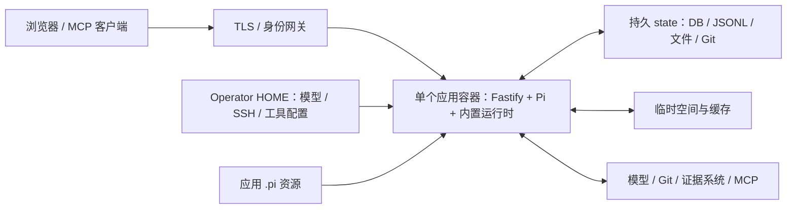

# 部署指南

生产使用一个内置 Node、Python/openpyxl、Git 和 Java/Maven 的应用镜像。Fastify 同源提供网页、API、SSE 和入站 MCP，业务数据独立持久化。已有状态升级先按[运维手册](RUNBOOK.md)备份和演练。

## 部署结构



应用代码、npm 生产依赖、Python `.venv` 和编译后的网页随镜像发布。启动不下载基础运行时，也不启动每工单容器或 Excel 服务。Bash 自动使用应用 `.venv`。

[Containerfile](../Containerfile) 使用 Node 构建网页、移除 dev 依赖，复制 Git 与 Java/Maven 产物，再安装 Python 库，以 UID/GID 1000 启动。Node 固定到主版本 26，Python 跟随 Debian bookworm，库版本见 [package-lock.json](../package-lock.json) 和 [requirements.txt](../requirements.txt)。基础镜像没有固定摘要，不能声称逐字节可复现。

## 首次本地运行

开发与 CI 使用 Node 24.18.0，需要 Python 3.8+（支持 venv）、Git、ripgrep、OpenSSH，以及目标项目需要的 npm、Java/Maven。在新项目副本检查[根配置](../issue-pilot.config.ts)，准备模型凭证和 SSH 配置后执行：

```bash
npm ci
python3 -m venv .venv
.venv/bin/python3 -m pip install -r requirements.txt
npm run build
node --experimental-strip-types src/http/production.ts
```

默认端口 3000。前端开发另运行 `npm run dev:web`，默认 4173，代理本机 API。修改 TS 文件不会自动重载后端，Vite HMR 不能代替发布。

默认 state 位于安装目录 `.issue-pilot`，没有 state/database 环境变量覆盖。隔离运行需要独立项目及根配置，不能启动第二个 API 指向真实 state。

已有工作站的 user systemd unit 为 `issue-pilot-api.service` 和 `issue-pilot-web.service`，由宿主管理，仓库不提供通用安装脚本。操作前核对 WorkingDirectory、ExecStart 和 PID：

```bash
systemctl --user show issue-pilot-api.service issue-pilot-web.service --property=MainPID,ExecStart,WorkingDirectory --no-pager
```

## 容器构建与 Kubernetes

在独立构建 checkout 按[开发指南](DEVELOPMENT.md#验证)完成检查，再构建和发布镜像：

```bash
podman build -f Containerfile -t registry.example.com/issue-pilot:<version> .
podman push registry.example.com/issue-pilot:<version>
```

构建网络需能访问基础镜像、锁文件 npm 下载地址、Python 包源、Debian 仓库和 Git 源码。替换 registry、版本和 namespace 占位符后，使用 [deploy/issue-pilot.yaml](../deploy/issue-pilot.yaml)。

清单为单副本、Recreate，使用本地 SQLite、进程内队列与受管 Git stores，不支持通过直接增加 replicas 共享写入。容器以 UID/GID 1000 运行，只读根文件系统，移除 capabilities，不自动挂载 ServiceAccount token。

| 宿主或 volume | 容器路径 | 内容 |
| --- | --- | --- |
| `/var/lib/issue-pilot` hostPath | `/opt/issue-pilot/.issue-pilot` | 全部业务 state |
| `/etc/issue-pilot`，只读 hostPath | `/home/node` | Operator Pi、SSH、工具配置 |
| tmp emptyDir | `/tmp` | 临时文件 |
| npm-cache emptyDir | `/home/node/.npm` | npm 缓存 |
| maven-cache emptyDir | `/home/node/.m2/repository` | Maven 缓存 |

准备目录、owner/mode、容量及带 `issue-pilot/state=true` 标签的节点。应用 `.pi` 资源独立于 Operator HOME；当前镜像不复制它，清单也未挂载，需要资源时明确部署到根配置位置，例如只读挂载 `/opt/issue-pilot/.pi`。

准备 namespace、配置、网关和数据后部署；已有数据先完成运维流程：

```bash
kubectl -n issue-pilot apply -f deploy/issue-pilot.yaml
kubectl -n issue-pilot rollout status deployment/issue-pilot --timeout=35m
kubectl -n issue-pilot get deployment,pod,service
```

清单不会创建外部 DNS、证书、网关或业务凭证。

## 网络与验收

可信网关负责认证，并约束已认证身份与 `X-Issue-Pilot-Subject` 的关系。保护 API、源码、下载、私有配置和 MCP，访问日志不记录完整敏感内容。反向代理禁用 SSE 缓冲并允许长连接。

应用层不设附件业务大小/数量上限，边缘限制由部署方明确；Agent 图片、MCP 和预览预算见根配置。模型、Git、证据目标及外部 MCP 需要对应网络；stdio MCP 的程序和依赖由部署环境准备。

`/health` 成功不等于所有工单、凭证或远程目标正常。启动、关闭和业务边界见[系统架构](ARCHITECTURE.md)，容器的可信执行边界见 [Agent 与能力](AGENT.md#执行边界)。发布验收与回退统一按[运维手册](RUNBOOK.md)执行。
