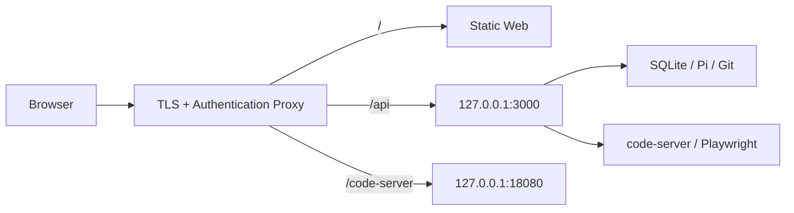

# 部署说明

本文帮助第一次接触 Issue Pilot 的维护者准备宿主环境、启动服务并完成首次验收。系统原理见 [架构说明](ARCHITECTURE.md)，部署完成后的日常维护见 [运维手册](RUNBOOK.md)。

## 部署前先理解

Issue Pilot 是可信单机应用，不是多租户 SaaS：

- API、SQLite、Pi 和 Git 都在同一台宿主机运行。
- code-server 和 Playwright 使用 Podman。
- Deployment credential 保存在本机 SQLite。
- API 没有内置身份认证。
- code-server 使用 `--auth none` 并提供终端。

因此推荐拓扑是：



`3000` 和 `18080` 只能监听 loopback。对外访问由同机反向代理提供 authentication、authorization、TLS 和审计。

## 运行前检查

### 固定 runtime

Issue Pilot 固定以下路径和版本，使 API、测试、project wrapper 和 code-server 使用相同工具链：

| Component | 路径或版本 |
| --- | --- |
| Node.js | `/usr/local/node`，24+ |
| Pi | `/usr/local/node/bin/pi`，0.84.1 |
| Java | `/usr/local/java` |
| Maven | `/usr/local/maven` |
| Git | `/usr/bin/git`、`/usr/libexec/git-core`、`/usr/share/git-core` |
| Aliyun CLI | `/usr/local/sbin/aliyun` |
| Playwright core | 1.62.1 |
| Browser image | `mcr.microsoft.com/playwright:v1.62.1-noble` |
| code-server image | `ghcr.io/coder/code-server:4.131.0-39` |

快速检查：

```bash
/usr/local/node/bin/node --version
/usr/local/node/bin/pi --version
/usr/local/java/bin/java -version
/usr/local/maven/bin/mvn --version
/usr/bin/git --version
/usr/local/sbin/aliyun version
podman version
```

还需要以下用户配置：

```text
~/.pi/agent/auth.json
~/.pi/agent/models.json
~/.pi/agent/models-store.json
~/.pi/agent/settings.json
~/.pi/agent/bin/rg
~/.pi/agent/bin/fd
~/.m2/settings.xml
~/.m2/repository
~/.npmrc
~/.npm
```

缺少固定 runtime 时，优先补齐宿主环境，不要通过修改 PATH、容器镜像或 wrapper 临时绕过。

### 安装依赖

```bash
npm ci
infra/playwright.sh prepare
infra/playwright.sh status
npm run typecheck
npm test
npm run build
```

## 项目配置

运行配置集中在根目录 `issue-pilot.config.ts`，API 不读取环境变量来覆盖这些值。

| 字段 | 当前值 | 说明 |
| --- | --- | --- |
| `state.directory` | `.issue-pilot` | 相对项目根目录的状态目录 |
| `state.databaseFile` | `issues.db` | 相对 state directory 的 SQLite 文件 |
| `state.sqliteBusyTimeoutMs` | `5000` | SQLite 等待并发锁的时间 |
| `regional.*` | `zh-CN`, `Asia/Shanghai` | 工单日期、Agent 时间上下文和页面时间显示；UTC offset 由时区计算 |
| `subject` | 配置文件中的账号 | 当前未认证操作人 |
| `http.*` | `127.0.0.1:3000` | API、logger 和 SSE heartbeat |
| `web.*` | `127.0.0.1:4173` | Vite dev server 和 Agent stream 重连间隔 |
| `defaults.*` | 见配置文件 | Environment、Deployment 和 capability 表单/API 共用默认值 |
| `workspace.*` | 见 [运维手册](RUNBOOK.md#项目配置) | Retention、quota 和 maintenance policy |
| `limits.*` | 见配置文件 | Agent、附件、进程和 capability 的 timeout/size/count 上限 |
| `runtime.codeServer.*` | `127.0.0.1:18080` | Public URL、监听地址、镜像、runtime label 和编辑器默认设置 |
| `runtime.playwright.*` | 见配置文件 | Tool/image 版本、浏览器 timeout、viewport 和容器资源 |
| `runtime.redisWorker.*` | 见配置文件 | Redis 隔离 worker heap |
| `runtime.containerUser`, `runtime.aliyunCli` | 见配置文件 | 临时容器用户 fallback 和 SLS CLI 路径 |

`src/config.ts` 只负责把 state 相对路径解析为绝对 `stateRoot` 和 `databaseFile`。`infra/config-value.mjs` 只让 Shell 脚本读取同一个根配置，不定义默认值。修改配置后需要重启 API；runtime image、port 或 version 改变时还要重新执行对应 `infra/*.sh prepare/ensure`。API、migration、Git 和 code-server 始终使用同一个 state root。

生产项目目录必须持久存在，不能在升级时用一个不包含原 `.issue-pilot` 的新目录替换。不要在 API 运行期间移动项目、`.issue-pilot` 或数据库。哪些内容可重建，见 [状态与所有权](ARCHITECTURE.md#状态与所有权)。

## 本机开发启动

初始化数据库：

```bash
npm run db:migrate
```

分别启动 API 和 Vite：

```bash
npm run server
```

```bash
npm run dev:web
```

| 服务 | 地址 |
| --- | --- |
| Web | `http://127.0.0.1:4173` |
| API | `http://127.0.0.1:3000` |
| code-server | `http://127.0.0.1:18080` |

Vite 已配置 `/api` 和 `/code-server` proxy，只用于开发。

## 首次业务配置

服务启动后，在 Web 配置页面完成：

1. 创建 Service。
2. 添加一个或多个 Repository。
3. 为需要的 Environment 添加 Deployment。
4. 填写 `baseBranch`。
5. 选择 Pi provider、model 和 thinking level。
6. 只启用确实需要的 capability，并填写连接信息。

字段含义和授权效果见 [配置说明](CONFIGURATION.md)。系统不提供业务 seed。

建议先创建一个 prod/test `smart_analysis` 工单，验证只读代码和 Agent 会话；再创建一个 dev 工单，验证独立工作分支和 worktree。

## 生产 API

下面的 systemd 示例使用独立低权限账号和固定项目目录：

```ini
[Unit]
Description=Issue Pilot API
After=network-online.target
Wants=network-online.target

[Service]
Type=simple
User=issue-pilot
Group=issue-pilot
WorkingDirectory=/opt/issue-pilot
Environment=PATH=/usr/local/node/bin:/usr/local/sbin:/usr/local/bin:/usr/sbin:/usr/bin
ExecStart=/usr/local/node/bin/node --experimental-strip-types src/http/api.ts
Restart=on-failure
RestartSec=3
TimeoutStopSec=120
UMask=0077
NoNewPrivileges=true

[Install]
WantedBy=multi-user.target
```

运行账号需要读写项目 `.issue-pilot`、Pi 配置、Git credential、Maven repository 和 npm cache。不要把 model key、数据库 password 或 capability credential 写进 unit；它们属于 Pi credential store 或 Deployment config。

```bash
sudo systemctl daemon-reload
sudo systemctl enable --now issue-pilot-api
sudo systemctl status issue-pilot-api
journalctl -u issue-pilot-api -f
```

## Production Web 与代理

`npm run build` 生成 `src/web/dist`。Web、API 和 code-server 建议使用同一受保护 origin。

Nginx 核心配置：

```nginx
root /opt/issue-pilot/src/web/dist;

location / {
    try_files $uri $uri/ /index.html;
}

location /api/ {
    proxy_pass http://127.0.0.1:3000;
    proxy_http_version 1.1;
    proxy_set_header Host $host;
    proxy_set_header X-Forwarded-Proto $scheme;
    proxy_buffering off;
    proxy_cache off;
    proxy_read_timeout 1h;
}

location /code-server/ {
    proxy_pass http://127.0.0.1:18080/;
    proxy_http_version 1.1;
    proxy_set_header Upgrade $http_upgrade;
    proxy_set_header Connection "upgrade";
    proxy_read_timeout 1h;
}
```

必须在这些 location 外层增加组织实际使用的认证和 TLS 策略。

Agent stream 使用 SSE，因此 `/api` 不能启用 response buffering 或短 read timeout。code-server 使用 WebSocket，需要 Upgrade headers。

## code-server

### 作用

所有工单共享一个 code-server 容器，但打开不同代码入口：

| Issue 状态 | Runtime repository link 指向 |
| --- | --- |
| 活动 dev | Writable Issue worktree |
| Prod/test | Deployment commit 的 shared checkout |
| Released dev | 本地工作分支 tip 的 shared checkout |

所有状态都通过 `runtime/<issue-key>.code-workspace` 打开。统一的 multi-root manifest 让 VS Code Git extension 能发现每个 Repository link，并显示 Source Control 与 Git Graph。

### 操作

```bash
infra/code-server.sh ensure
infra/code-server.sh status
infra/code-server.sh stop
```

`ensure` 默认使用该项目配置解析出的 state root；API 调用时会显式传入同一个绝对路径。镜像、监听端口、runtime label 和 `chat.disableAIFeatures` 默认值由脚本通过 `infra/config-value.mjs` 从根配置读取，Shell 中没有第二份默认值。

### Mounts

| Host | Container | Mode |
| --- | --- | --- |
| `.issue-pilot/workspaces` | `/home/coder/state/workspaces` | read-write |
| `.issue-pilot/git/repositories` | `/home/coder/state/git/repositories` | read-write |
| `.issue-pilot/issues` | `/home/coder/state/issues` | read-only |
| `.issue-pilot/git/checkouts` | `/home/coder/state/git/checkouts` | read-only |
| `/usr/local/node` | `/opt/host/node` | read-only |
| `/usr/local/java` | `/opt/host/java` | read-only |
| `/usr/local/maven` | `/opt/host/maven` | read-only |
| Host Git binary、exec path、templates、libs | `/opt/host/git` | read-only |

Repository cache 需要 read-write，因为 dev worktree 的 Git index 和 metadata 位于 bare repository。Issue data 和 immutable checkout 在容器中保持只读。

Host Git 与容器内 Git 必须是同一版本；只挂载 binary 不足以支持 relative worktree metadata，所以 exec path、templates 和动态库也固定挂载。

## Playwright 与 SLS runtime

Playwright 管理命令：

```bash
infra/playwright.sh prepare
infra/playwright.sh status
infra/playwright.sh clean
```

每次 Playwright capability 调用都会创建私有 request/credential files，启动 `--rm` Chromium 容器，限制访问到 Deployment origin，返回 bounded 结果后删除临时目录。不会创建持久 browser container。

SLS 固定调用宿主 `/usr/local/sbin/aliyun`。每次查询创建临时 HOME 和 `0600` profile，不读取或修改 operator 的持久 Aliyun profile。

## 安全边界

### 网络

- API 和 code-server 只能监听 loopback。
- 外部入口必须由代理执行 authentication、authorization 和 TLS。
- `/api/config` 应单独限制并审计。
- 不信任同一 LAN 内的匿名访问者。

### Secret

`GET /api/config` 返回真实保存的 password 和 AccessKey。禁止记录：

- Config request/response body
- Authorization、Cookie
- Deployment password 或 AccessKey
- Playwright credential file
- code-server `container.env`
- 包含敏感业务数据的完整 capability result

SQLite、backup、Pi JSONL 和 code-server data 都按敏感数据管理。

### 本地权限

Pi built-in file tools 不是操作系统 sandbox。API/Pi 必须使用专用低权限账号，不能以 root 运行。code-server 提供终端，访问 code-server 等同于获得该运行账号的本地操作能力。

## 首次验收

部署完成后至少检查：

```bash
curl -fsS http://127.0.0.1:3000/health
curl -fsS http://127.0.0.1:3000/api/me
infra/playwright.sh status
infra/code-server.sh status
ss -ltnp | rg ':3000|:18080'
```

再通过 Web 验证：

- Service、Repository 和 Deployment 正确。
- Model 与 thinking level 可用。
- Prod/test 只有只读 tools，没有 Issue workspace。
- Dev 创建正确的 hotfix/feature branch。
- Agent 事件可以实时显示，刷新后仍能 replay。
- 所有 code-server 会话使用 Issue multi-root runtime，全部 Repository 的 Git Graph 可见。
- Attachment 可以预览/下载，文件 mode 和 hash 正确。

已有工单的部署应做全量代码验收，而不是只抽查一个 URL：逐个读取 `/api/issues/<key>`，确认 code-server URL 返回 200；解析对应 `.code-workspace`，确认每个 folder link 可达；以 `GIT_OPTIONAL_LOCKS=0` 只读检查 HEAD、branch ref、`git status --porcelain` 和最近 Git log。Prod/test 应为 detached read-only checkout，dev runtime HEAD 应等于本地 working branch ref。

日常健康检查和数据库验证命令见 [运维手册](RUNBOOK.md#日常检查)。
