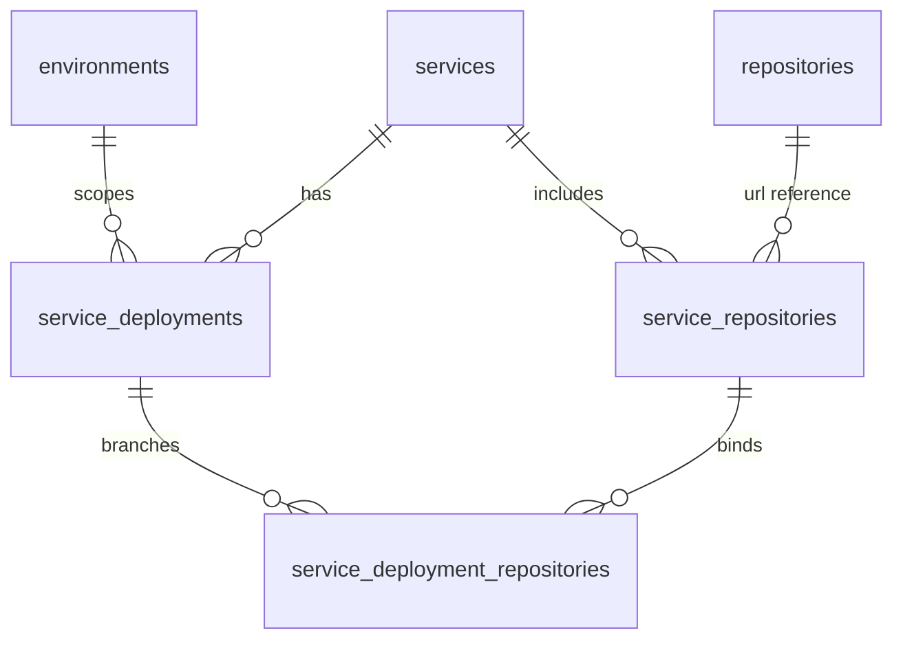
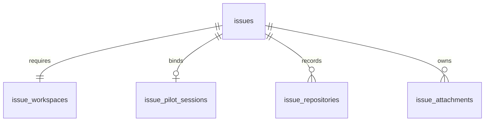
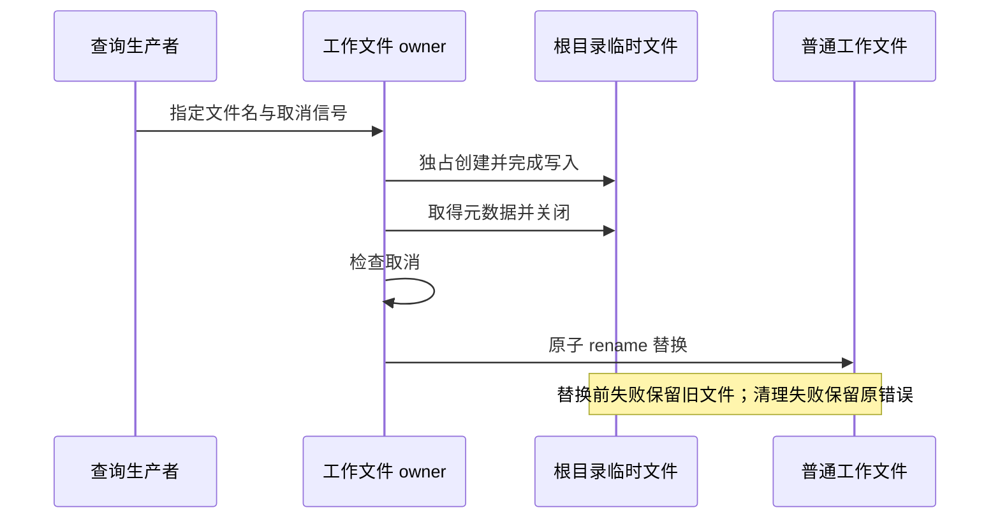
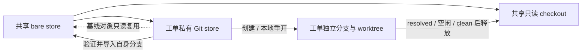

# 数据存储设计

系统用 SQLite 保存业务关系，用 Pi JSONL 保存对话，用普通文件保存附件和成果，用 Git 保存代码。恢复工单需要这些事实相互匹配，不能只恢复数据库。

## 数据分别放在哪里

| 存储 | 内容 | 所有者 |
| --- | --- | --- |
| SQLite | 用户、配置、工单、范围、附件元数据、工作区和会话绑定 | [schema.ts](../src/db/schema.ts) |
| Pi JSONL | Agent 消息、工具结果、会话分支 | [pi-session.ts](../src/agent/pi-session.ts) |
| 附件原件 | 工单根目录中的 `.attachment-*`，一份文件对应一条元数据 | [attachment-store.ts](../src/http/attachment-store.ts) |
| 工单根目录 | 代码、脚本、中间结果、会话、运行文件及交付文件，跨轮次保留 | [state.ts](../src/workspace/state.ts)、各资源 owner |
| 工作文件 | 普通工作文件；查询导出原子写入同一目录 | [work-files.ts](../src/workspace/work-files.ts) |
| Git store/worktree | objects、refs、提交与未提交代码 | [git.ts](../src/workspace/git.ts)、[issue-git.ts](../src/workspace/issue-git.ts) |

对话没有另建 SQL 消息表，成果也没有单独的数据库表。人工工单评论存放在 `issue_comments`，与 Agent 对话分开。

## 数据表关系

服务、环境、仓库和分支分层配置：仓库目录按 URL 去重，服务设置 alias，部署指定各仓库的 base branch。



`service_deployments` 的服务/环境组合唯一，`config` JSON 保存原生能力目标与凭证。服务仓库的 alias/URL 可以在一次配置事务中交换；变化的绑定保留原 ID 和创建时间，部署分支关联在同一事务内重建。全局模型配置、原生能力开关和外部 MCP 分别保存在 `global_agent_configuration`、`capability_switches`、`mcp_services`。用户与个人凭证由 `subjects`、`user_credentials` 保存。



| 工单表 | 关键事实 |
| --- | --- |
| issues | 服务、环境、类型、状态、reporter/assignee、解决时间 |
| issue_workspaces | 准备/运行状态、runtime_ready、last_error |
| issue_pilot_sessions | Pi JSONL 路径与 work 路径 |
| issue_repositories | URL、base/working branch、local_path、workspace_name、commit_before |
| issue_attachments | objectKey、原始文件名、working_file_name、mediaType、size、SHA-256、上传者 |
| issue_service_scopes | 显式加入服务的意图，用于准备代码集合 |
| issue_scope_transitions | 范围变更前后值、操作者、plan hash、仓库增减快照 |
| issue_comments / issue_cc_recipients | 人工评论与抄送人 |
| issue_relations / issue_pins | 有方向且不能关联自身的工单关系、用户个人置顶 |

`issues.id` 是内部 UUID，外键使用它；`issues.key` 是 `ISSUE-YYYYMMDD-NNN...` 业务编号，HTTP 工单 DTO 的 `id` 使用业务编号。编号日期按配置时区生成，磁盘目录使用小写编号。

每张 Issue 必须恰有一条 Workspace：主键保证至多一条，创建事务与启动校验保证不能缺失。工单必须匹配有效 Deployment；`resolved` 与非空 `resolved_at` 等价。完整字段见 schema，部分约束位于迁移 SQL 的触发器中。

## 目录布局

默认路径如下，owner 为 [config.ts](../src/config.ts)、[state.ts](../src/workspace/state.ts) 和 [runtime.ts](../src/workspace/runtime.ts)。

```text
应用目录/
├── issue-pilot.config.ts
├── .venv/                              # 安装生成的 Python 环境
└── .issue-pilot/
    ├── service.yaml                    # 离线导入／导出资料，不在启动读取
    ├── user.yaml                       # 离线私有资料，0600，不是运行权威源
    ├── mcp.json                        # 可选：MCP 连接与 MySQL 启动模板
    ├── issues.db                       # SQLite 主文件，0600
    ├── issues.db-wal / issues.db-shm     # 运行中的数据库文件组
    ├── git/repositories/<url-hash>/     # 全局 bare store，由应用维护
    ├── git/checkouts/<url-hash>/<commit>/
    ├── workspaces/<issue-key>/          # 唯一工单根目录及 Agent cwd
    │   ├── <repo>/                     # 开发 worktree；其他状态为只读快照链接
    │   ├── .issue-git/<url-hash>/       # 工单持久 Git store（refs、索引、新对象）
    │   ├── .session-<name>.jsonl        # Pi 对话，0600
    │   ├── .attachment-<id>.<ext>       # 原始附件，0400
    │   ├── <working-file>               # 显式创建的普通工作文件；不自动复制附件
    │   ├── .issue-runtime.json         # 应用生成资源的归属清单
    │   ├── .related-<key>              # 关联工单完整目录的只读引用
    │   ├── .related-<key>.json          # 准备工作区时的关联元信息快照
    │   ├── .related-<key>.jsonl         # 关联会话引用（存在时）
    │   ├── .legacy-output-links.json   # 离线迁移索引；正常运行不读取（存在时）
    │   ├── .runtime-legacy-*           # 迁移保留的历史运行文件（存在时）
    │   ├── .runtime-proxy-*.conf        # 临时执行网络配置，随执行/连接关闭清理
    │   ├── .npm-cache/ / .maven-cache/ # 工单内包缓存，按需生成
    │   ├── .cache/ / node-compile-cache/ # 工具与 Node 编译缓存，按需生成
    │   ├── query.py / checkpoint.json
    │   └── report.xlsx                # 普通工作及交付文件
    └── control/                        # 应用实例租约、离线迁移记录
```

代码、原件、显式创建的工作文件、JSONL 和运行元数据直接属于该工单根目录，不再另设 `agent/attachments/outputs/runtime/work` 包装目录。代码通过 `state.ts` 的 `issueRoot(stateRoot, issueKey)` 解析这一位置；会话、附件和运行时不再各自保留同义路径函数。旧布局路径仅由 `legacyIssueRoot` 表示，供离线迁移及未迁移状态拒绝检查使用。前端“附件”通过附件 API 读取原件，“工作目录”浏览当前文件，支持按需预览及下载；应用管理文件只列名称，不提供原始内容下载。仓库和关联工单目录按受控只读根解析，拒绝 Git 控制文件、越界链接和特殊文件；目录超过预算时明确报错。

默认全局 Pi 目录是 Operator 的 `~/.pi/agent`，模型、认证、settings、skills 等保存在这里；其 `sessions/` 与工单根目录中的 `.session-*.jsonl` 分开。完整恢复点放在 state root 之外，例如 `~/issue-pilot-backups`，只保留策略要求的完整快照，历史小型操作记录和独立恢复证据另行归档。`node_modules`、`.venv` 和编译后的网页属于应用安装产物，不放进工单业务目录。

新布局不再创建 `issues/<key>/work`、`agent`、`attachments`、`outputs` 或 `runtime` 包装目录。空的旧布局父目录可在确认没有数据和引用后移除。正常运行只读取当前工作文件，不扫描旧成果目录或迁移索引。

旧 `issues/<key>` 内容必须显式离线迁移；启动遇到未迁移内容报 `issue_layout_migration_required`。迁移保留开发 worktree 原路径，更新附件和会话绑定，保存历史成果映射。遇到未知目录、冲突或校验失败先保留现场；已识别的历史运行文件也保留到根目录，不因重新生成运行资源而丢失内容。步骤见[运维手册](RUNBOOK.md#工单工作目录迁移)。

关联目录指向关联工单的实际文件，包括未提交代码、附件、对话和工作文件。`.related-<key>.json` 是准备时快照；会话链接指向当时数据库绑定的 JSONL，源工单更换会话文件后需要重新准备引用。复用开发会话的继续轮次不会自动刷新这些元信息，也没有自动关联摘要。模型本地操作在 SRT 中执行，关联工单只读；完整信任边界见[执行边界](AGENT.md#执行边界)。

Skills、Prompts、Extensions、模型定义与全局指令统一从 Operator HOME 的全局 Pi 配置读取；应用不再另外设置资源目录。日常业务配置保存在 SQLite；启动不加载旧 YAML／JSON。显式离线导入保留事务与实例租约，历史身份、工作区路径和退役资料保持原样。user_preferences 保存个人钉钉来源／字段偏好，application_settings 保存并发上限、共享字段映射及 MySQL stdio 模板。subjects／repositories／services／user_credentials 的 revision 用于页面保存冲突检测。MySQL 目标属于部署 config，mcp_services.deployment_id 标记相应生成连接并以外键级联删除，普通 API 不输出秘密。配置的单一来源和启用方式见[配置与协议](CONFIGURATION.md)。

## 文件写入与发布

附件先暂存并计算 size/hash，再写入工单事务对应的持久文件和元数据。原始文件名完整保留在元数据和下载响应中；物理存储名含 UUID，按 UTF-8 字节限制裁剪描述部分并保留可容纳的扩展名，避免 UUID 前缀使长文件名超出文件系统限制。持久文件为私有 `0400` regular file，读取校验路径、类型、精确的 `0400` 权限、size 和 SHA-256；不自动修复异常权限。下载先用固定大小缓冲校验，再从同一描述符流式发送，验证失败不发送附件内容，客户端取消时关闭描述符。完整预校验与随后发送会产生两次文件读取，以有界内存换取发送前完整性检查；不能把这一优化描述成必然降低下载延迟。删除先 quarantine，事务失败恢复，提交后 finalize；失败的回滚或最终化必须报告，保留证据。暂存文件清理等待所有目录删除结束，并保留原操作及清理两类错误。

粘贴到 Agent 的图片属于 Pi 消息，不进入附件表。消息成功接收前，文字和图片先保存在同一 Pi JSONL 的 `issue-pilot-user` 条目中；队列执行时使用该次输入，不重复追加显示条目。只保存了用户条目不表示模型已经处理，也不会在进程启动时自动执行。新版排队条目附带版本 1 的原处理范围，`issue-pilot-user-delivery` 自定义条目记录 started 或 rejected；主动重试只恢复尚未交付的新版输入，历史无标记消息不作待办推断。这些交付条目不进入普通会话显示，也不存放模型或 SSH 凭证。已有绑定的 JSONL 缺失时不另建会话或改绑；文件不完整时保留现场并拒绝追加，不能通过截断原文件让接收成功。

附件仅保存一份 `.attachment-*` 原件，权限为 `0400`。附件下载及 Agent 新建会话的准备阶段共用描述符校验：核对类型、权限、DB 大小和 SHA-256；内容变化即使不改变大小也会拒绝，保留原件供核查。下载复用已校验描述符，不按路径重新打开；Agent 准备校验后关闭描述符，再交由原生工具读取。该检查不构成持续文件监控，也不能阻止受信任进程在校验后修改数据。Agent 直接通过原生工具或已安装库读取，准备和继续处理时都不自动创建可编辑副本。需要修改内容时显式另存为普通工作文件。附件 DTO 仅报告原件的 `storedFileName`，不再生成或返回 `workingFileName`；历史数据库列及离线迁移记录保留，已有副本作为可能修改过的普通文件保留。

成果直接使用普通工作文件，不再执行独立发布或复制快照。DMS 导出写入工单根目录，返回 `downloadPath`；所有工单类型均可使用已配置且有凭证的 DMS 导出，不再由 `canWriteOutputs` 决定。前端将工作路径统一映射到工作文件下载 API；会话中保留的旧路径前缀也只规范化为当前路径。后台已移除旧成果下载路由和 Issue 详情的 `outputs` 字段，不再读取 `.legacy-output-links.json`。显式离线迁移仍会保留同名异内容交付的摘要后缀文件及对应迁移索引，供恢复核对使用；这些索引不参与服务请求。



查询导出文件名按 `limits.filesystemNameBytes` 限制 UTF-8 字节数，并拒绝管理文件、路径和非普通目标；生产者运行前完成校验。同名任务按实际目标路径跨存储实例串行，排队期间取消不启动生产者。DMS 协议收尾成功后才替换文件，已经提交的 rename 不自动回滚。SQLite 事务不会撤销文件和 Git 操作，各 owner 分别负责 prepare、rollback 和 finalize。

代码浏览器保存代码时先核对客户端读取的 SHA-256，过期内容返回 `source_file_changed`。临时文件通过独占 open 取得所有权，写完关闭后原子替换源文件；临时名已存在时保留原路径。写入失败只清理本次创建且尚未发布的临时文件，成功 rename 后不再删除已经释放的临时名称。原失败与清理失败同时存在时聚合为 `source_save_cleanup_failed`，保留未清理内容供核查。

## Git 与工作区

开发工作树的索引、工作分支和新对象属于工单根目录中的 `.issue-git/<url-hash>`，属于持久 Git 数据，不能当 runtime 缓存删除。公共基线对象通过只读 alternates 复用；没有跨工单可写硬链接。SRT 允许当前工单 Git 的正常 add/commit，但配置、hooks、alternates、绑定指针和发布检查点只由应用维护。可信 Git 操作前检查私有 store 的真实路径，拒绝符号链接、特殊文件和多链接文件。

首次准备会把已验证绑定的共享 worktree 元数据迁入工单，保留原 index、HEAD、dirty/untracked 文件及旧注册证据，失败恢复原指针。分支或路径漂移继续拒绝；不收编未知目录。释放或生成分支快照时，应用导入对象，再以原发布提交为条件 compare-and-swap 该工单分支；发现共享 ref 被其他操作更改时拒绝覆盖。重开直接使用工单私有本地分支。旧共享库及其他工单始终不获得模型写权限。

私有 store 的 origin 保留标准 `+refs/heads/*:refs/remotes/origin/*` fetch 映射；应用配置校验接受指向自身 origin 的安全分支跟踪项。模型工具中的 Git 配置仍是只读，常规推送可显式指定 `git push origin <branch>`。需要写入配置的 `git config`、`remote` 或 `push -u` 操作由受信操作者在工单空闲并核对身份后维护；如果远端推送已成功但本地跟踪写入失败，应先核对远端提交，不能因此自动重提或强推。

同 URL 的共享 bare store 复用基线 objects 和保留 refs，开发工单的活动分支、索引和新对象由各自私有 store 管理。仓库记录是历史执行事实，当前服务配置不能重写过去的分支和路径。

| 仓库集合状态 | local_path | working_branch | 访问 |
| --- | --- | --- | --- |
| read_only | 全 NULL | 全 NULL | 正式/测试只读快照 |
| development_workspace | 全非空 | 全非空 | 活动开发 worktree |
| development_snapshot | 全 NULL | 全非空 | 已释放开发工作区的本地分支快照 |
| invalid | 空集合、混合或其他布局 | — | 拒绝并检查 |



初次或只读准备按需 fetch 远程分支，并以完整 `refs/remotes/origin/<branch>` 解析基线，避免同名标签遮蔽。共享 checkout 在启动检查和运行中复用时都检查 HEAD、已跟踪修改、untracked 和 ignored 内容；异常时拒绝复用并保留现场。已记录 working branch 的准备和重开只使用本地 store/ref，不 fetch，也不在 ref 缺失时回退到远程或 reset。分支存在性检查仅把 `show-ref --exists` 的返回码 2 视为确实缺失；损坏 ref、缺失对象及其他 Git 执行错误继续报告，不作为可缺省的关联快照处理。释放前检查已登记仓库的布局、当前分支和 staged／untracked／ignored 状态。Git 忽略的文件或目录也可能是报告、检查点或其他本地成果，存在时拒绝自动释放，不按名称猜测其可再生性；确需删除的依赖缓存由使用者显式处理。工单根目录允许其他文件和目录，释放只移除登记的干净 worktree，保留脚本、附件副本与检查点。分支不匹配或 detached 时拒绝，批量移除失败按原 ref/commit 恢复。

Workspace 存储统计的 `totalBytes` 只累计各工单根目录，包含其中的工作文件、附件、会话和私有 Git 历史；自动回收触发线与目标值继续使用这个范围。`sharedGitBytes` 单独测量 state root 下的 `git` 目录，涵盖共享 bare store 和只读 checkout，不并入工单回收阈值，也不随释放工单自动删除。数值是按目录采样的分配空间，沿用最长 60 秒的统计缓存，不代表整个宿主机磁盘占用或同一时刻的完整快照。释放返回值是工单目录的减少量，不承诺共享历史也被回收。

工作区检查保留路径、分支和运行视图 owner 的具体错误码。Git 元数据链接失效、Git 无法执行和 Git 状态读取失败分别报告稳定码，不将命令行、stderr 或内部路径作为公开 blockedReason。页面展示具体含义，并在悬停提示中保留短错误码；未知短码也可用于定位，不再统称“安全检查未通过”。真实绑定异常继续阻止释放，不自动改 `.git`、索引或历史记录。

自动维护只处理已解决、空闲的开发工单；Workspace 标记为 failed 不单独构成删除依据。单个候选的会话关闭、Git 操作或视图重建异常记录在内部维护结果的 failures 中，启动和定时维护按工单报告原错误，继续处理其他候选。失败后重新测量该工单目录，避免已经移除代码但视图尚未恢复时仍按旧占用计数。数据库列表或整体磁盘测量等全局故障继续报错，不当成单个工单失败吞掉。

代码释放完成后，运行视图重建失败会记录 runtimeReady=false 和 lastError，并向调用方报告失败。检查结果区分 `workspace_runtime_not_ready` 与 `workspace_runtime_restore_failed`，不再将两者笼统归为仓库状态损坏。下一轮维护重新检查后可重试受管视图恢复。已有释放记录但视图未完成的候选会先恢复生成视图，不依赖保留期或当前空间压力；在工单预约内重新确认仓库为已释放快照，不借此删除仍活动的 checkout。同一轮不重复处理该候选，不回退远程分支、不改写本地 refs，也不重放 Agent 或证据查询。

`issue_service_scopes` 保存 include/remove 的服务意图，仓库按 URL 去重，同 URL 分支冲突拒绝。意图先持久化，再准备跨介质资源；失败保留事实供重试，不伪造完成状态。

实现见 [git.ts](../src/workspace/git.ts)、[project.ts](../src/workspace/project.ts)、[lifecycle.ts](../src/workspace/lifecycle.ts)。

## 一致性与恢复单位

SQLite 使用本地 libSQL 客户端，启动启用 WAL 和外键，数据库文件为 `0600`。timestamp 使用秒，与恢复 SQL 的 `unixepoch()` 一致。配置读取显式使用原生 read transaction，避免普通读取占用写权限；Drizzle 当前适配器不能代替这一步。

已发布迁移 SQL 和 journal 不可修改；变更新增迁移，同时验证 fresh DB 与升级。实现见 [bootstrap.ts](../src/db/bootstrap.ts)、[read.ts](../src/configuration/read.ts) 和 [drizzle](../drizzle)。

| 分类 | 内容 | 处理 |
| --- | --- | --- |
| 持久 | DB/WAL/SHM、JSONL、原始附件、工作文件、离线迁移索引、本地 Git refs/objects | 使用匹配的完整恢复点 |
| 有条件持久 | 活动开发 worktree | 满足释放条件前保留未提交、staged、untracked 和 ignored 内容 |
| 生成 | runtime 元数据、网络临时配置、实例控制 socket、受管 checkout、工单内包缓存 | 确认归属和状态正常后由 owner 处理 |
| 配置 | 根配置、私有 YAML/MCP 文件、全局 Pi 配置与 Operator 工具配置 | 与目标版本一起部署和备份 |
| 安装产物 | node_modules、`.venv`、编译后网页 | 根据匹配版本重新生成 |

“生成”不代表异常时可以直接删除。未知目录、变化的 checkout 和隔离文件可能是恢复证据。凭证的普通 GET 隐藏投影也不等于存储加密，数据库、JSONL、成果和备份均需按敏感数据管理。

备份、保留与恢复操作只在[运维手册](RUNBOOK.md)维护。
