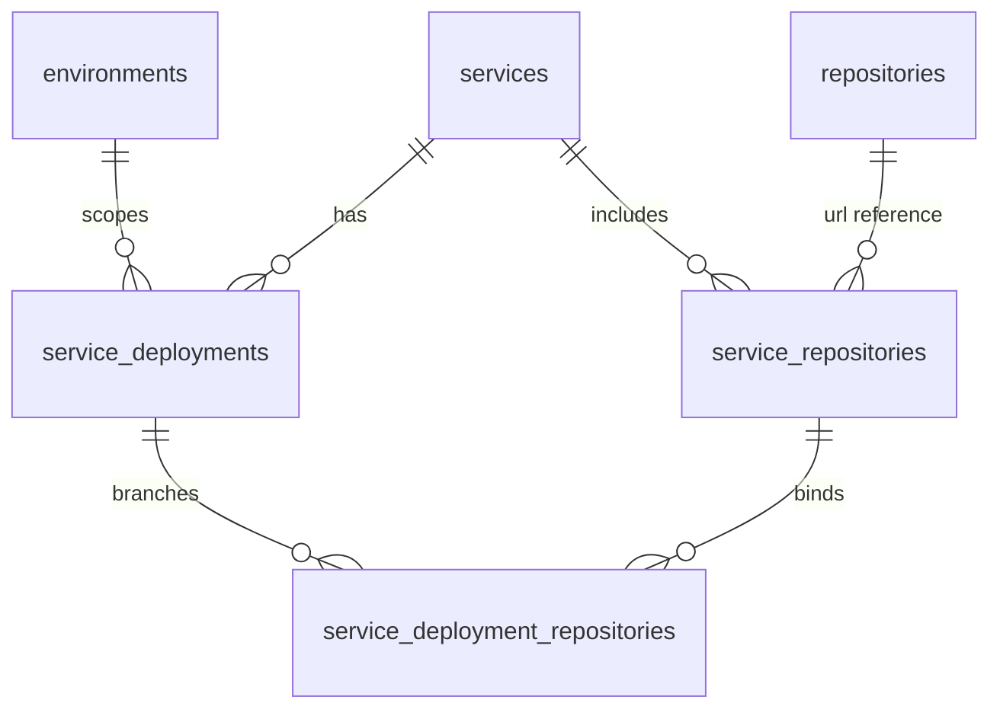
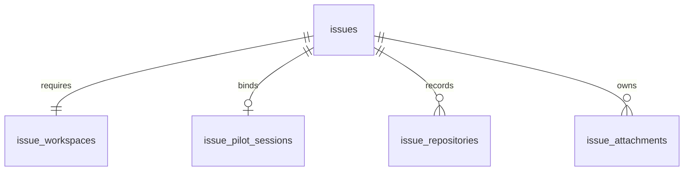
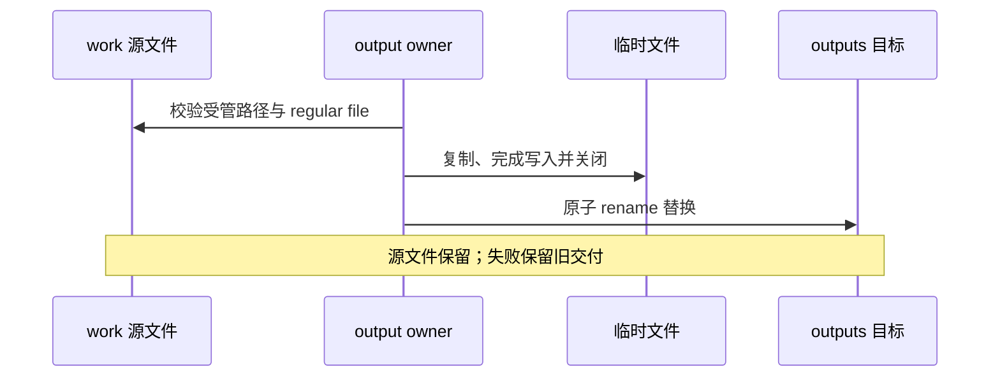
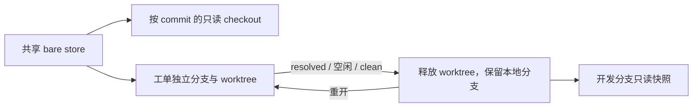

# 数据存储设计

系统用 SQLite 保存业务关系，用 Pi JSONL 保存对话，用普通文件保存附件和成果，用 Git 保存代码。恢复工单需要这些事实相互匹配，不能只恢复数据库。

## 数据分别放在哪里

| 存储 | 内容 | 所有者 |
| --- | --- | --- |
| SQLite | 用户、配置、工单、范围、附件元数据、工作区和会话绑定 | [schema.ts](../src/db/schema.ts) |
| Pi JSONL | Agent 消息、工具结果、会话分支 | [pi-session.ts](../src/agent/pi-session.ts) |
| attachments | 原始附件，一份文件对应一条元数据 | [attachment-store.ts](../src/http/attachment-store.ts) |
| work | 脚本、中间结果、检查点，跨轮次保留 | Agent 普通文件操作 |
| outputs | 显式发布的交付成果，从目录生成列表 | [store.ts](../src/outputs/store.ts) |
| Git store/worktree | objects、refs、提交与未提交代码 | [git.ts](../src/workspace/git.ts) |

对话没有另建 SQL 消息表，成果也没有单独的数据库表。人工工单评论存放在 `issue_comments`，与 Agent 对话分开。

## 数据表关系

服务、环境、仓库和分支分层配置：仓库目录按 URL 去重，服务设置 alias，部署指定各仓库的 base branch。



`service_deployments` 的服务/环境组合唯一，`config` JSON 保存原生能力目标与凭证。全局模型配置、原生能力开关和外部 MCP 分别保存在 `global_agent_configuration`、`capability_switches`、`mcp_services`。用户与个人凭证由 `subjects`、`user_credentials` 保存。



| 工单表 | 关键事实 |
| --- | --- |
| issues | 服务、环境、类型、状态、reporter/assignee、解决时间 |
| issue_workspaces | 准备/运行状态、runtime_ready、last_error |
| issue_pilot_sessions | Pi JSONL 路径与 work 路径 |
| issue_repositories | URL、base/working branch、local_path、workspace_name、commit_before |
| issue_attachments | objectKey、原始文件名、mediaType、size、SHA-256、上传者 |
| issue_service_scopes | 显式加入服务的意图，用于准备代码集合 |
| issue_scope_transitions | 范围变更前后值、操作者、plan hash、仓库增减快照 |
| issue_comments / issue_cc_recipients | 人工评论与抄送人 |
| issue_relations / issue_pins | 有方向且不能关联自身的工单关系、用户个人置顶 |

`issues.id` 是内部 UUID，外键使用它；`issues.key` 是 `ISSUE-YYYYMMDD-NNN...` 业务编号，HTTP 工单 DTO 的 `id` 使用业务编号。编号日期按配置时区生成，磁盘目录使用小写编号。

每张 Issue 必须恰有一条 Workspace：主键保证至多一条，创建事务与启动校验保证不能缺失。工单必须匹配有效 Deployment；`resolved` 与非空 `resolved_at` 等价。完整字段见 schema，部分约束位于迁移 SQL 的触发器中。

## 目录布局

默认路径如下，owner 为 [config.ts](../src/config.ts)、[state.ts](../src/workspace/state.ts) 和 [runtime.ts](../src/workspace/runtime.ts)。

```text
应用目录/
├── issue-pilot.config.ts
├── .venv/                              # 安装生成的 Python 环境
├── .pi/                                # 应用 Skills / Prompts / 扩展 / 指令
└── .issue-pilot/
    ├── issues.db                       # SQLite，可能有 -wal、-shm
    ├── issues/<issue-key>/
    │   ├── agent/                      # Pi JSONL
    │   ├── attachments/                # objectKey 命名的原始文件
    │   ├── work/                       # Agent cwd
    │   ├── outputs/                    # 已发布成果
    │   └── runtime/                    # 生成的仓库与关联证据链接
    ├── git/repositories/<url-hash>/     # bare store
    ├── git/checkouts/<url-hash>/<commit>/
    ├── workspaces/<issue-key>/<repo>/   # 活动开发 worktree
    └── control/                        # 项目 broker socket 等生成资源
```

`runtime` 是资源视图，不是另一份代码事实。关联工单可以提供元数据、持久会话链接和本地开发分支快照，不暴露其他工单未提交的 worktree 作为快照。

应用 `.pi` 与 Operator HOME 中的模型认证、SSH 和工具配置是不同位置，部署时分别管理，见[部署指南](DEPLOYMENT.md)。

## 文件写入与发布

附件先暂存并计算 size/hash，再写入工单事务对应的持久文件和元数据。持久文件为私有 `0400` regular file，读取校验路径、类型、size 和 SHA-256。删除先 quarantine，事务失败恢复，提交后 finalize；失败的回滚或最终化必须报告，保留证据。

粘贴到 Agent 的图片属于 Pi 消息，不进入附件表。

成果从 work 中的普通文件显式发布：



成果文件名限制在本工单 outputs 内。MySQL/DMS 导出复用成果存储，但先完成协议收尾再发布。SQLite 事务不会撤销文件移动或 Git 操作，因此各 owner 分别承担 prepare、rollback 和 finalize。

## Git 与工作区

同 URL 的 bare store 复用 objects 和 refs，开发工单使用独立 working branch/worktree。仓库记录是历史执行事实，当前服务配置不能重写过去的分支和路径。

| 仓库集合状态 | local_path | working_branch | 访问 |
| --- | --- | --- | --- |
| read_only | 全 NULL | 全 NULL | 正式/测试只读快照 |
| development_workspace | 全非空 | 全非空 | 活动开发 worktree |
| development_snapshot | 全 NULL | 全非空 | 已释放开发工作区的本地分支快照 |
| invalid | 空集合、混合或其他布局 | — | 拒绝并检查 |



初次或只读准备按需 fetch 远程分支；已记录 working branch 的准备和重开只使用本地 store/ref，不 fetch，也不在 ref 缺失时回退到远程或 reset。释放前检查布局和 staged/untracked 状态，批量移除失败按原 ref/commit 恢复。

`issue_service_scopes` 保存 include/remove 的服务意图，仓库按 URL 去重，同 URL 分支冲突拒绝。意图先持久化，再准备跨介质资源；失败保留事实供重试，不伪造完成状态。

实现见 [git.ts](../src/workspace/git.ts)、[project.ts](../src/workspace/project.ts)、[lifecycle.ts](../src/workspace/lifecycle.ts)。

## 一致性与恢复单位

SQLite 使用本地 libSQL 客户端，启动启用 WAL 和外键，数据库文件为 `0600`。timestamp 使用秒，与恢复 SQL 的 `unixepoch()` 一致。配置读取显式使用原生 read transaction，避免普通读取占用写权限；Drizzle 当前适配器不能代替这一步。

已发布迁移 SQL 和 journal 不可修改；变更新增迁移，同时验证 fresh DB 与升级。实现见 [bootstrap.ts](../src/db/bootstrap.ts)、[read.ts](../src/configuration/read.ts) 和 [drizzle](../drizzle)。

| 分类 | 内容 | 处理 |
| --- | --- | --- |
| 持久 | DB/WAL/SHM、JSONL、附件、work、outputs、本地 Git refs/objects | 使用匹配的完整恢复点 |
| 有条件持久 | 活动开发 worktree | 满足释放条件前保留未提交、staged 和 untracked 内容 |
| 生成 | runtime、wrapper、socket、受管 checkout | 确认归属和状态正常后由 owner 处理 |
| 配置 | 根配置、应用 `.pi`、Operator HOME | 与目标版本一起部署和备份 |
| 安装产物 | node_modules、`.venv`、编译后网页 | 根据匹配版本重新生成 |

“生成”不代表异常时可以直接删除。未知目录、变化的 checkout 和隔离文件可能是恢复证据。凭证的普通 GET 隐藏投影也不等于存储加密，数据库、JSONL、成果和备份均需按敏感数据管理。

备份、保留与恢复操作只在[运维手册](RUNBOOK.md)维护。
