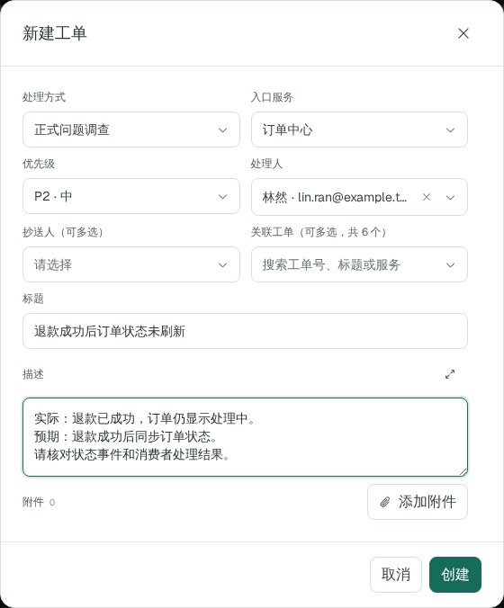
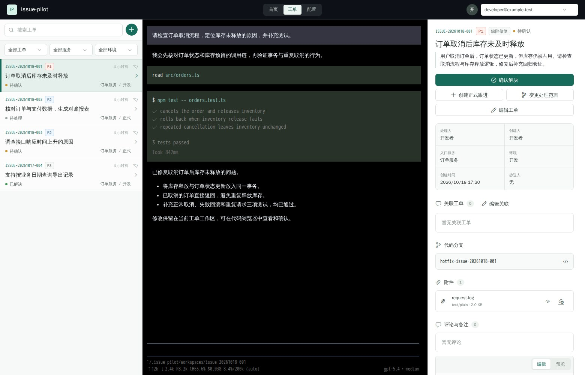
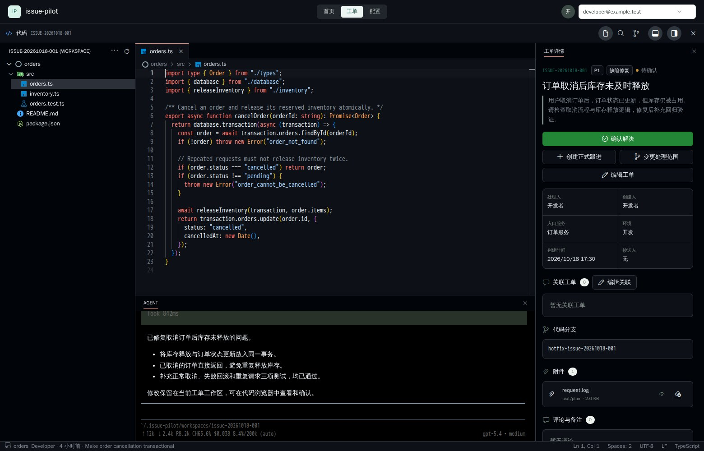

# 使用指南

[文档导航](README.md) · [配置](CONFIGURATION.md) · [界面预览](images/index.html)

## 创建与导入

右上角选择自己的账号。进入“工单”点击新建，选择处理方式和入口服务，填写标题、实际现象、预期结果与验收要求；处理人、附件、抄送和关联按需填写。创建后 Agent 自动开始处理。

| 处理方式 | 代码视图 |
| --- | --- |
| 正式问题调查 | 正式环境只读快照 |
| 测试问题调查 | 测试环境只读快照 |
| 开发缺陷修复 | 工单独立分支 |
| 开发功能开发 | 工单独立分支 |

顶部“钉钉”支持单条记录链接导入，工单指派给当前调用身份。导入成功后关闭弹窗并打开工单；新工单启动 Agent，重复记录打开已有工单。

MCP 客户端从“配置 → 端点”复制本人配置，连接后用 `users_list` 核对身份。工具参数、默认指派和启动行为见[入站工单 MCP](CONFIGURATION.md#入站工单-mcp)。创建响应不明时先查询确认。

## 查看与继续

左侧选择工单，中间看 Agent 对话和执行结果，右侧查看描述、附件、关联、代码与工作目录。文字和图片直接在当前对话补充。

| 状态 | 操作 |
| --- | --- |
| 正在处理 | 查看进展，按页面提供的方式补充或中止 |
| 待确认 | 检查结果，继续反馈或确认解决 |
| 失败／环境未就绪 | 按错误提示修正凭证或网络，再重试 |
| 已解决 | 有新情况时重开 |

消息受理表示输入已保存，模型可能仍在排队。发送结果不明时先核对对话和文件，再决定是否重发。

## 文件与代码

附件原件只读，要修改时另存工作文件。脚本、表格、核对记录和报告从工作目录预览或下载。对话中粘贴的图片属于该条消息。

“浏览工单代码”提供文件与差异视图。调查工单只读，活动开发工单可编辑、暂存和提交。服务基线更新不会重置工单已有分支或修改。

关联工单提供只读证据，重要结论需核对源文件和版本。关联元信息在准备时取快照，不是实时同步摘要。

## 范围与结果

服务或处理方式需要改变时，使用“变更处理范围”并确认预检结果；相关任务运行时会阻止冲突变更。普通补充和文件下载沿用当前范围。

结果符合要求后“确认解决”，仍有问题就继续反馈。解决保留对话、附件、工作文件和持久分支，代码目录按维护策略回收；工单可以重开。

## 重置会话

开发者可在“编辑工单”底部点击“重置”，与“保存”并列，无二次确认。重置先保存当前字段和附件修改，成功后保留旧对话并创建新会话；新会话不带入旧聊天，代码、附件和工作文件保留。旧对话通过“查看历史”只读查看。发送下一条消息时按当前工单详情、凭据和范围准备资源。重置不自动启动处理，运行中和已解决工单不能重置。保存失败不重置；保存成功但重置失败时明确提示部分成功，保留编辑器，重试不会重复上传已保存附件。

## 设置与提示

个人凭证在“配置 → 用户”维护，共享 DMS／SLS 凭据由开发者在同页集中维护；服务只填写查询范围。服务与仓库由有权限的维护者登记。环境能力、保存和冲突规则统一见[配置与协议](CONFIGURATION.md)。

- 缺少凭证：检查当前处理人的对应配置。
- 配置冲突：保留草稿，按提示重载或等待活动任务结束。
- 保存成功但刷新失败：重试读取。
- 工作区／Git 异常：保留现场和错误码，按[运维手册](RUNBOOK.md)检查。
