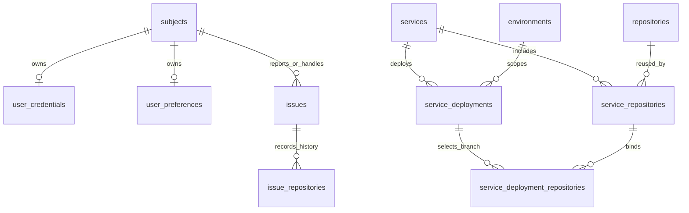

# 配置页：用户、仓库、服务、端点与数据存储

> 历史设计与原型记录。字段与交互已有后续调整，原型不代表现版全部行为；操作请看[使用指南](../USAGE.md)、[配置与协议](../CONFIGURATION.md)和[当前界面](../images/README.md)。

这是已确认原型对应的设计与实现说明，配套 [可点击原型](configuration-prototype.html) 和 [桌面／手机预览](configuration-preview/index.html)。页面维护和 SQLite 单一业务来源已于 2026-10-25 完成主机部署，既有偏好已存入数据库，旧文件配置的导入、导出、转换链路已退役。原型展示的是切换后的日常操作，不提供 user.yaml／service.yaml 的维护或预览入口。原型使用独立演示数据，仅在本浏览器会话保存，刷新可保留；关闭该标签页后结束。不调用应用 API，不保存密钥正文。

## 1. 页面与操作

入口固定为「用户 → 仓库 → 服务 → 端点」，默认打开用户。用户和仓库沿用新版维护方案；服务保留当前产品的结构和编辑流程，端点保留当前接入配置功能。不新增项目、仓库组、人员服务归属或通用配置中心。

### 用户：我的凭证在上，人员在下

上方沿用已认可的四组：模型 API Key、Git SSH、DMS、SLS。状态卡只显示是否配置；打开弹窗直接填写新值，已配置项留空保留，不需要先选“保留／替换”模式。底部只有取消／保存，清除以低强调的独立入口提供。DMS 地址＋Authorization、SLS ID＋Secret 仍作为完整组填写。凭证正文不回显、不存入原型 sessionStorage。DMS、SLS 清除个人组后按已有规则使用部署配置；模型／SSH 缺失不能借用他人身份。

下方是人员列表，显示姓名、邮箱、角色、管理权限和启停状态。新增人员默认产品角色；账号按邮箱预填但创建后固定，修改邮箱不改变 subject。业务角色为产品／测试／开发，isAdmin 独立。停用保留历史，不做物理删除。用户不能查看或填写别人的秘密；管理人员修改角色、启停沿用已有后端约束。

钉钉不属于个人凭证，也不在本页出现。钉钉全局连接由 MCP 管理；个人来源与字段映射是偏好，不是访问身份。

原型提供停用成员用于验证“显示停用人员”：默认隐藏，勾选后出现，启用后回归正常列表。右上角可切换演示身份，个人凭证状态、端点配置及可编辑权限随身份更新；产品／测试角色可看配置并维护自身允许的凭证，开发者维护服务／仓库，管理权限独立设置。最终产品仍需后端授权，不能用隐藏按钮代替授权。

### 服务：保留当前页面和环境部署编辑

桌面采用参考图中的居中分段服务 Tab：浅色圆角底座、白色选中项，右侧固定“添加”“编辑”，下方代码分支独立成卡片。手机端保持单行横向滚动。详情仍按 ServiceOverview 的信息顺序：先显示“代码分支”（仓库为行，开发／测试／正式为列），再显示服务描述和各环境调查参数。

添加／编辑沿用当前字段顺序：

1. 服务名称。
2. 从仓库目录多选已登记仓库。地址和显示名在仓库页维护，不在服务表单内登记新仓库，不要求手写 alias。
3. 环境部署按开发／测试／正式分行展开。正式、测试分支可编辑；开发代码基线只读继承同仓库的正式分支，不再单独设置。正式分支的草稿修改即时更新开发侧显示，不重绘整个表单；正式分支为空时显示“待配置正式分支”，不回退到独立默认值。新增正式／测试分支仍预填 main。开发查询能力继续继承正式／测试来源，不提供开发独立目标。展开、收起、增删目标及调整仓库时不丢草稿。
4. 服务描述（Markdown）位于表单下方。

保留当前 DMS／SLS 的具体 owner 和按环境配置方式。环境展示使用当前数据库／HTTP 目标契约：MySQL 显示 host／port／username／password／database；DMS 显示 alias／schema；SLS 显示 region／project／logstores，存在 name 时一并展示。每个服务、正式／测试环境分别保存和展示对应目标，不把正式目标复用到测试，不添加无关的解析 ID、MCP 生成名或状态字段。列表支持多个目标；字段内容使用完整演示值。

MySQL 执行仍通过全局 MCP；原字段仅作为迁移映射依据，页面维护后由同一配置 owner 保存和生成连接。展示不重新引入原生 MySQL 查询能力。正式实现中普通配置 GET 的凭证投影仍需保留；这里的完整字段属于明确选定服务的私有配置详情。

原型已补齐各环境 MySQL／DMS／SLS 目标的新增、编辑和移除；字段结构保持已有含义，不要求用户编辑文件。取消只丢弃草稿，保存后各服务／环境独立更新。开发环境不创建独立分支输入和查询目标，代码基线取正式分支；开发工单仍使用自己的工作区和开发分支，不能把基线继承理解为直接修改正式分支。

用户与仓库交互改进不要求重写服务后端 DTO。

### 仓库：维护一次地址，查看使用位置

仓库页是可复用代码目录，显示名称、地址和使用服务；服务名可跳到服务详情。支持登记、改名、改地址及删除未使用仓库。

- 显示名是纯元数据，修改不影响工单运行。
- 地址变更影响实际绑定的入口／包含服务工单，沿用当前预约与会话关闭，不阻塞其他工单。
- 被服务使用的仓库不直接删除，先到服务解除关联；关联移除本身仍要经过当前安全规则。
- 地址更新不改写历史工单 URL、分支、工作目录或 Git refs。

仓库统一在此登记，服务页只选择已有仓库。独立入口保留给整理地址、改名和查看复用关系。

### 端点：保留当前客户端接入配置

沿用 EndpointConfiguration：选择 Pi／Cursor／Claude Code、VS Code 或 Codex 格式，查看当前身份、复制配置、展开工具说明。这里是 Issue Pilot 提供给外部客户端的入站 MCP 地址，不是个人凭证或钉钉连接管理。原型使用 example.test 地址和演示身份，支持格式切换和复制；不会发起网络连接。

## 2. 数据关系

用户、服务、仓库不是三级上下级。用户通过工单的 reporter／assignee 参与工作，服务聚合一个或多个仓库，仓库可被多个服务复用。分支归“服务 × 环境 × 仓库关联”，不能放成仓库全局唯一分支。user_preferences 与 application_settings 已由追加迁移 0063 创建，其余关系复用当前 schema；工单仍保留原执行事实。开发行是正式分支的派生视图，不是另一份分支配置。

| 数据 | 落点 | 处理方式 |
| --- | --- | --- |
| 姓名、邮箱、角色、isAdmin、启停 | subjects（现有） | 页面修改；subject 固定，停用保留历史 |
| provider → 模型 API Key、SSH 私钥、个人 DMS/SLS | user_credentials（现有） | 每人一行，复用现有具体列；普通 GET 只返回状态 |
| 个人钉钉来源、字段映射 | user_preferences（0063 新增） | subject 为主键／外键，dingtalk JSON 只存 source／fields，无 Key／连接授权 |
| 仓库显示名、URL | repositories（现有） | URL 唯一，一次登记，多处选择 |
| 服务名、稳定 key、说明 | services（现有） | 名称可改，key 不随名称改 |
| 服务关联的仓库 | service_repositories（现有） | 关联 ID 保持，alias 后端生成，不让用户手填 |
| 正式／测试／开发是否存在 | service_deployments（现有） | service_id + environment_id 唯一，不勾选不创建 |
| 环境分支 | service_deployment_repositories（现有） | 正式／测试每关联每环境一行；开发基线从正式读取，不另存一份可编辑分支值 |
| DMS/SLS 连接、精确目标 | service_deployments.config（现有） | 保留明确的 dms／sls 结构及个人完整组覆盖，不增加任意类型插件表 |
| 全局 MCP，含钉钉连接 | mcp_services（现有） | 含授权的 URL／header／stdio 为私有；个人不再保存钉钉凭证 |
| 全局模型、思考、Codemode、runtime | global_agent_configuration（现有） | 全局一行，不放进人员或服务部署 |
| 钉钉共享默认字段映射 | application_settings（0063 新增单行表） | id=1，dingtalkFields JSON；另保存 maxConcurrentIssues、mysqlStdio 这两个具体运行设置 |
| 工单仓库地址、分支、路径、基线 | issue_repositories（现有） | 运行与恢复 owner 管理，不由当前配置反向改写 |

不在本轮把 service_repositories.url 改成 repository_id：现有 URL 外键已级联、关联 ID 已稳定，页面简化不需要全库重建。将来确有多地址／仓库身份需求再调整。

新表是具体业务结构，不采用 key/value 配置表或 schema 可扩展引擎。user_preferences 不属于凭证表，以免读取本人 Key 状态时加载无关业务来源。

开发正式基线规则已在本次实现中落实：在 `workspace/deployment.ts` 的仓库／分支 owner 中集中处理：请求开发代码基线时，读取同服务对应正式部署的仓库分支；缺少正式分支时明确拒绝。读取、描述和新工单准备复用这一个规则，不在 Web 和 Agent 各自复制默认值。配置保存只接收正式／测试分支，不接受开发覆盖。上线前核对并保留已有开发配置差异；已有工单的 branch、commit、path 仍按历史事实恢复，不回写或 reset。原型以空 dev 映射标记开发视图，存储中不保存按仓库复制的正式分支值。

## 3. 唯一来源与存储边界

**页面维护，SQLite 是业务配置唯一来源。** 根运行配置继续保存路径、端口、配额、超时等部署参数。user／service YAML 的加载、导入、导出和转换均已移除；标准 MCP JSON API 与 Pi 原生配置保留。

启动只做数据库 migration、运行状态恢复和工作区准备，不从旧文件重写业务配置。文件优先模式、自动双向同步、旧配置转换及跨账号凭证补齐工具均不再提供。

SQLite 延续现有私有权限和备份制度。服务目标或私钥存入 DB 不等于已加密；DB、WAL、备份都按含凭证文件处理。现阶段不引入外部密钥服务或自制加密层。用户表单只发送保留／替换／清除动作；清空输入不能隐式删掉凭证。

对话、粘贴图片仍属于 Pi JSONL；原始附件仍是工单目录下 0400 文件；代码、交付、Git 分支仍用现有磁盘和 Git。配置表不存文件副本，也不引入 LayerFS。

## 4. 写入和失效规则

| 操作 | 保存范围 | 对工单的影响 |
| --- | --- | --- |
| 新增人员 | subjects 一行 | 不创建凭证、不影响服务或仓库 |
| 停用／改角色／换凭证 | 现有用户 owner | 预约相关工单、等待后重授权；有活动任务时明确失败，保留输入 |
| 新增服务 | 已登记仓库引用、服务及部署关联的一次 SQLite 事务 | 复用当前 prepare/apply 与影响范围预约，不涉及新仓库创建 |
| 关联已有仓库 | 服务关联及已启用环境分支 | 复用已有 prepare/apply，冲突拒绝 |
| 改服务分支／调查目标 | 对应部署和关联 | 仍按跨服务调查规则失效相关环境会话，不缩成“只看入口服务” |
| 仓库改名 | repositories.name | 无会话关闭 |
| 仓库改 URL | 全局目录 + FK 级联 | 只处理实际使用服务的工单；不移动现有 checkout |
| 删除仓库／环境 | 当前配置 | 若仍有服务引用／历史工单范围引用，保持原有拒绝规则 |

服务保存继续复用现有 prepare/apply，引用已登记仓库并在单笔事务内保存服务、关联及部署分支。不新增草稿仓库表或“服务 + 新仓库”的原子复合入口。仓库页使用现有独立 API，服务与仓库的维护入口清楚区分。

页面保存成功后刷新 ApplicationResources 中的用户／目录／服务数据。请求失败保留输入，身份变化取消尚未发出的保存并清理秘密；不新增前端全局状态库。浏览器页面留存与后台任务状态的现有约束保持。

原型不模拟多人并发修改。当前 API 仍可能由后保存者覆盖配置，且现有 updatedAt 以秒存储，不能单独充当可靠冲突版本。已在 subjects、repositories、services、user_credentials 各增加整数 revision 列：GET 返回版本，更新在现有队列内以 expectedRevision 作条件并递增，冲突返回 409、保留草稿。服务 revision 覆盖其关联和部署整体；个人凭证仅由本人写入且不回显秘密，保留／替换仍由凭证 owner 处理。不新增版本表、事件日志框架或配置副本。

## 5. 当前来源边界

来源切换已完成，旧版本的导入记录仅作为历史发布证据，当前版本不再保留或执行相应脚本。页面和 HTTP owner 维护数据库中的业务值，启动不会根据历史文件投影、补齐或改写它们。

人员凭证仍按本人和完整组处理；标准 MCP JSON 由其接口导入／编辑，不重新引入用户与服务文件格式。缺失当前配置时通过业务入口处理，不能自动采用另一份旧文件或另一身份。恢复继续使用匹配代码与完整状态恢复点，不把配置文件导出当成备份替代品。

真实 state 中已有的旧文件保留为未知私有材料，本次源码清理不自动删除、迁移或改写这些文件，也不修改既有 SQLite 配置、会话或 Git 事实。

## 6. 验收与当前产物范围

原型已实现：用户／仓库／服务／端点固定顺序，默认用户页；四组凭证状态及简化更新弹窗（直接填写、留空保留、独立清除入口）；人员搜索、增改启停；仓库登记、编辑、未使用删除及使用服务跳转；按环境显示并编辑 MySQL、DMS、SLS 的完整演示字段（含 MySQL password），支持多目标增改删；当前服务顶部 Tab、代码分支矩阵、服务描述、按环境展开的编辑表单，服务新增、编辑、取消、删除、历史占用拒绝及刷新留存；演示身份切换、个人凭证状态隔离；端点客户端格式切换、复制和工具说明。密钥输入只改变布尔演示状态，正文不进入 sessionStorage。无网络请求。

原型未实现：真实身份认证与后端授权、工单预约／运行冲突、远程连接验证、配置导入导出、多人并发保存。人员角色和历史占用只由演示数据模拟。个人凭证正文不会写入浏览器存储，但服务 MySQL password 按用户要求属于可展示的演示配置，会与目标一起保存在当前浏览器会话。这些在上文存储与交付设计中有定义，不能把原型保存成功当成后端已具备对应事务。

正式实现验收至少覆盖：服务保存事务失败不留下半个部署；仓库同 URL 不重复登记；移除未选环境不误删历史；人员停用和最后管理者约束；跨身份草稿隔离；保存服务不丢 SLS 多目标；旧文件在重启后不覆盖页面；凭证空白保留、明确清除及日志脱敏。完整类型／后端／前端／构建检查和真实桌面、手机保存验收在实现阶段执行。

## 7. 本次原型验证

使用 Playwright 1.62.1、既有 `mcr.microsoft.com/playwright:v1.62.1-noble` 镜像，在禁用网络的容器中读取本地 HTML，以 1440 × 1000、390 × 1000 验收：

- 停用成员默认隐藏，勾选可见、取消隐藏；复选框 14px 且与文字垂直中心偏差小于 4px。人员新增、编辑、停用和启用生效。
- 简化凭证弹窗直接填写、留空保留；个人秘密不进入浏览器存储。切换身份后凭证状态隔离，端点身份同步更新，产品／测试不能改服务配置。
- 页面没有日常 YAML 预览／维护入口。MySQL／DMS／SLS 的新增、编辑、移除、保存、取消和刷新生效，环境目标相互独立。
- 有历史工单的服务阻止删除；新服务确认删除后消失，仓库仍保留，解除引用后可删除未使用仓库。
- 添加、移除目标后保留弹窗滚动位置，新增目标的首个输入框可见且获得焦点；未保存的其他分支不丢失。原版 DMS 添加回归先复现从 639px 跳到 0，再确认三类目标在桌面／手机均通过。
- 开发环境按最新约定只读继承正式分支：无开发输入框或独立覆盖值；正式草稿即时同步，缺失值明确提示；新建／编辑、仓库增删、保存／刷新和取消均通过回归，开发工单的独立工作区语义保留。
- 端点格式切换、复制内容验证通过，四个页面无页面横向溢出和 pageerror。

剪贴板写入使用 stub 验证内容，不宣称验证系统剪贴板权限。证据见 [verification.json](configuration-preview/verification.json)，截图见 [预览](configuration-preview/index.html)。

## 8. 文案收敛

原型页面去掉重复的功能介绍、用途说明、弹窗副标题和页脚实现解释；演示标记集中到一处。开发继承规则在列表表头／编辑环境摘要中各说明一次，不逐仓库重复。目标类型使用区块标题，按钮简化为添加／移除并保留完整 aria-label。字段名称、输入格式、未配置／停用状态、历史占用和删除确认、错误反馈保留。

以桌面和手机重新验证了停用筛选、凭证空白保留／替换、仓库登记、服务正式分支与开发基线同步、目标添加移除的滚动及草稿、取消／保存、端点复制与身份切换，无页面错误或横向溢出。截图已更新，详细结果见 verification.json 的 copyCleanup。

以上第 7、8 节记录原型阶段的浏览器验证。实际产品实现包含追加迁移、后端接口和页面；旧文件配置工具已退役，另执行完整产品检查与真实 API／浏览器验收；详细结果见[实现与验收](../reviews/configuration-workflows.md)。实际部署与状态核对见上述实现记录。
